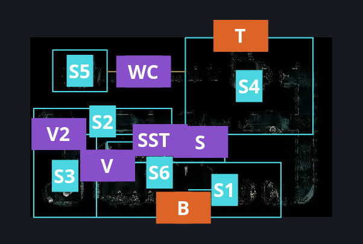
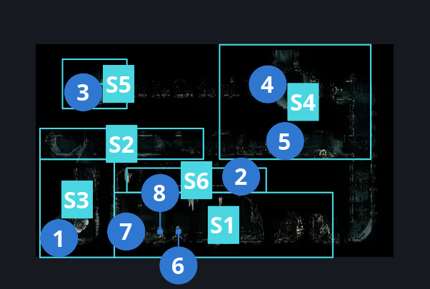
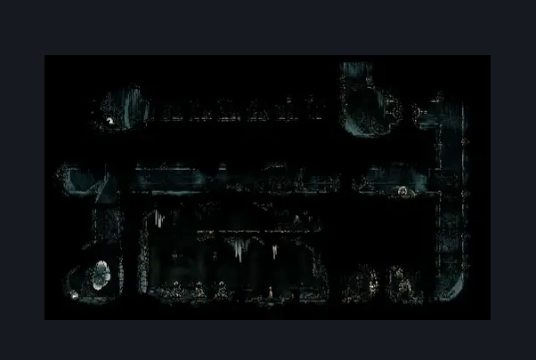

# Confession Toll (Under_08)

**Game ID:** Under_08

**Contributors:** samupo and Rebel

## Subrooms

| No. | Subroom | Annotated |
| --- | --- | --- |
| S1 | Base | ✓ |
| S2 | Top | ✓ |
| S3 | Memory | ✓ |
| S4 | Whiteward Entrance | ✓ |
| S5 | Psalm Cylinder | ✓ |
| S6 | Shell Shards | ✓ |

## Room Transitions

| Alias | Name | From subroom | Destination | Destination alias | Requirements | TODO | Verification | Annotated | Notes |
| --- | --- | --- | --- | --- | --- | --- | --- | --- | --- |
| T | top1 | Whiteward Entrance | [Whiteward Unravelled Arena Room (Ward_02)](../whiteward/whiteward-unravelled-arena-room.md) | B | Defeat The Unravelled Gauntlet IN Whiteward Unravelled Arena Room |  | Verified | ✓ | has to be checked from white ward |
| B | bot1 | Base | [Underworks Below Confession (Under_06)](underworks-below-confession.md) | T | none |  | Verified | ✓ |  |

## Subroom Connections

| Alias | Name | Source | Destination | Requirements | TODO | Verification | Annotated | Notes |
| --- | --- | --- | --- | --- | --- | --- | --- | --- |
| V | Base to Shards | Base | Shell Shards | (cling grip Left AND (faydown cloak OR dash Right OR sharpdart OR drifter's cloak OR ledge grab Right OR Easy Architect Charge OR Easy Beast Charge OR (Proficient Movement AND Architect Attack Right) OR Easy Shaman Pogo OR Easy Wanderer Charge OR Easy Reaper Charge OR Easy Hunter Pogo OR Easy Reaper Pogo OR Easy Witch Pogo OR Easy Flintslate Stall OR Easy Plasmium Stall OR Easy Voltvessels Stall OR Easy Flea Brew Stall OR Flea Brew)) OR (Scuttlebrace AND Faydown Cloak AND (Dash Right OR Clawline Right OR Sharpdart)) OR silk soar OR (Cling Grip Right AND Faydown Cloak) |  | Verified | ✓ |  |
| V | Base to Shards | Shell Shards | Base | Nothing. (Fall) |  | Verified | ✓ |  |
| SST | Shell Shards <> Top | Shell Shards | Top | Silk Soar OR Faydown Cloak OR Cling Grip Either OR Scuttlebrace OR Ledge Grab Either |  | Verified | ✓ |  |
| SST | Shell Shards <> Top | Top | Shell Shards | Nothing. (Fall) |  | Verified | ✓ |  |
| V2 | Top To Memory | Top | Memory | Nothing. (Fall) |  | Verified | ✓ | check cling grip as well when there's no ledge grab |
| V2 | Top To Memory | Memory | Top | Cling Grip Either OR Scuttlebrace OR Silk Soar |  | Verified | ✓ |  |
| S | Secret to Top | Whiteward Entrance | Top | Open Airlock Right AND Activate Whiteward Side Scaffold Wall |  | Verified | ✓ |  |
| S | Secret to Top | Top | Whiteward Entrance | Open Airlock Left AND Activate Whiteward Side Scaffold Wall AND (Silk Soar OR Cling Grip Either OR Scuttlebrace) |  | Verified | ✓ |  |
| WC | Whiteward <> Cylinder | Whiteward Entrance | Psalm Cylinder | Activate Whiteward Side Breakable Wall |  | Verified | ✓ |  |
| WC | Whiteward <> Cylinder | Psalm Cylinder | Whiteward Entrance | Activate Whiteward Side Breakable Wall |  | Verified | ✓ |  |

## Check Locations

| No. | Check | Subroom | Requirements | TODO | Verification | Location Type | Annotated | Notes |
| --- | --- | --- | --- | --- | --- | --- | --- | --- |
| 1 | Underworks Lamp-lit Memory Locket | Memory | none |  | Verified | collectible | ✓ | based on in-game coords, this is named incorrectly - hero, 9/26 uhhhhhhhhhhhhhh best i can do is fixing the location. - rebel, 10/2 |
| 2 | Shell Shard Cache: Underworks #15 | Shell Shards | none |  | Verified | collectible | ✓ |  |
| 3 | Underworks Sealed Away Psalm Cylinder | Psalm Cylinder | Nothing |  | Verified | collectible | ✓ |  |
| 4 | Whiteward Side Breakable Wall | Whiteward Entrance | Break Wall Left |  | Verified | blockade | ✓ |  |
| 5 | Whiteward Side Scaffold Wall | Whiteward Entrance | Break Wall Left |  | Verified | blockade | ✓ |  |
| 6 | The Three Toll Bench Musketeers (Youngest) | Base | Unlock Toll Bench Musketeer Arming Fees - Youngest |  | Verified | bench | ✓ |  |
| 7 | The Three Toll Bench Musketeers (Middle) | Base | Unlock Toll Bench Musketeer Arming Fees - Middle |  | Verified | bench | ✓ |  |
| 8 | The Three Toll Bench Musketeers (Oldest) | Base | Unlock Toll Bench Musketeer Arming Fees - Oldest |  | Verified | bench | ✓ |  |
| 9 | Toll Bench Musketeer Arming Fees - Youngest | Base | Spend 15 Rosaries |  | Verified | lock |  |  |
| 10 | Toll Bench Musketeer Arming Fees - Middle | Base | Spend 15 Rosaries |  | Verified | lock |  |  |
| 11 | Toll Bench Musketeer Arming Fees - Oldest | Base | Spend 15 Rosaries |  | Verified | lock |  |  |

## Room Images

### Connections

### Checks

### Scene

