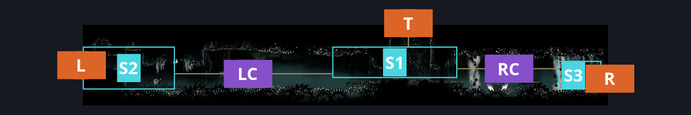
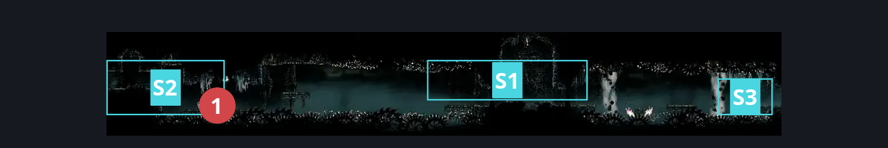
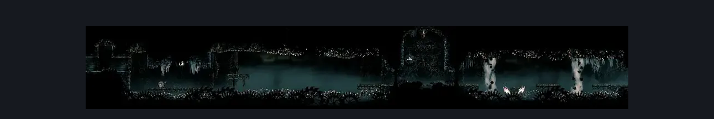

# Underworks Below Confession (Under_06)

**Game ID:** Under_06

**Contributors:** samupo and Rebel

## Subrooms

| No. | Subroom | Annotated |
| --- | --- | --- |
| S1 | Center | ✓ |
| S2 | Left | ✓ |
| S3 | Right | ✓ |

## Room Transitions

| Alias | Name | From subroom | Destination | Destination alias | Requirements | TODO | Verification | Annotated | Notes |
| --- | --- | --- | --- | --- | --- | --- | --- | --- | --- |
| L | left1 | Left | [Underworks Western Gauntlet (Under_07)](underworks-western-gauntlet.md) | R | none |  | Verified | ✓ |  |
| T | top1 | Center | [Confession Toll (Under_08)](confession-toll.md) | B | Open Airlock Up AND (Cling Grip Either OR Silk Soar OR Scuttlebrace OR (Faydown Cloak AND Ledge Grab Either)) |  | Verified | ✓ |  |
| R | right1 | Right | [Underworks Central Shaft (Under_05)](underworks-central-shaft.md) | TL | none |  | Verified | ✓ |  |

## Subroom Connections

| Alias | Name | Source | Destination | Requirements | TODO | Verification | Annotated | Notes |
| --- | --- | --- | --- | --- | --- | --- | --- | --- |
| LC | Left-Center | Left | Center | Nothing. |  | Verified | ✓ | unsure if Left and Center should be merged. |
| LC | Left-Center | Center | Left | Nothing. |  | Verified | ✓ | unsure if Left and Center should be merged. |
| RC | Right-Center | Right | Center | spike pogo OR dash Left OR clawline Left OR Sharpdart OR Faydown Cloak OR Drifter's Cloak OR Easy Beast Charge OR Easy Architect Charge OR Easy Voltvessels Stall OR Easy Plasmium Stall OR Flea Brew |  | Verified | ✓ |  |
| RC | Right-Center | Center | Right | spike pogo OR dash right OR clawline Right OR Sharpdart OR Faydown Cloak OR Drifter's Cloak OR Easy Beast Charge OR Easy Architect Charge OR Easy Voltvessels Stall OR Easy Plasmium Stall OR Flea Brew |  | Verified | ✓ | Very hard for me to verify |

## Check Locations

| No. | Check | Subroom | Requirements | TODO | Verification | Location Type | Annotated | Notes |
| --- | --- | --- | --- | --- | --- | --- | --- | --- |
| 1 | Underworker 1 | Left | nada |  | Verified | enemy | ✓ |  |

## Room Images

### Connections

### Checks

### Scene

