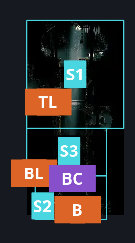
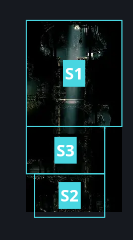
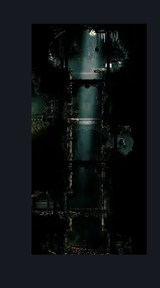

# Underworks Clawline Entrance (Under_19c)

**Game ID:** Under_19c

**Contributors:** Rebel, Cry

## Subrooms

| No. | Subroom | Annotated |
| --- | --- | --- |
| S1 | Top | ✓ |
| S2 | Bottom | ✓ |
| S3 | Center | ✓ |

## Room Transitions

| Alias | Name | From subroom | Destination | Destination alias | Requirements | TODO | Verification | Annotated | Notes |
| --- | --- | --- | --- | --- | --- | --- | --- | --- | --- |
| TL | left1 | Top | [Underworks Clawline Room (Under_18)](underworks-clawline-room.md) | R | Nothing. |  | Verified | ✓ |  |
| BL | left2 | Center | [Underworks Craftmetal Corridor (Under_19b)](underworks-craftmetal-corridor.md) | R | Nothing. |  | Verified | ✓ |  |
| B | bot1 | Bottom | [Underworks Lava Flow Corridor (Under_19)](underworks-lava-flow-corridor.md) | T | Nothing. |  | Verified | ✓ |  |

## Subroom Connections

| Alias | Name | Source | Destination | Requirements | TODO | Verification | Annotated | Notes |
| --- | --- | --- | --- | --- | --- | --- | --- | --- |
| BC | B-C | Bottom | Center | Silk Soar  OR Cling Grip Either  OR (Easy Scuttlebrace AND (Easy Shaman Pogo  OR Faydown Cloak  OR Easy Flea Brew Stall)) OR (Faydown Cloak  AND (Ledge Grab Left  OR (Elite Ball Knowledge AND Dash Left  AND (Medium [Flea Brew] Stall x 2  OR (Medium Beast Heal Stall AND Medium [Beast, Shaman] Pogo))))) |  | Verified | ✓ |  |
| BC | B-C | Center | Bottom | Nothing. (Fall) |  | Verified | ✓ |  |
| CT | C-T | Center | Top | Silk Soar OR Cling Grip Either OR Easy Scuttlebrace |  | Verified |  |  |
| CT | C-T | Top | Center | Nothing. (Fall) |  | Verified |  |  |

## Check Locations

No check locations defined.

## Room Images

### Connections

### Checks

### Scene

