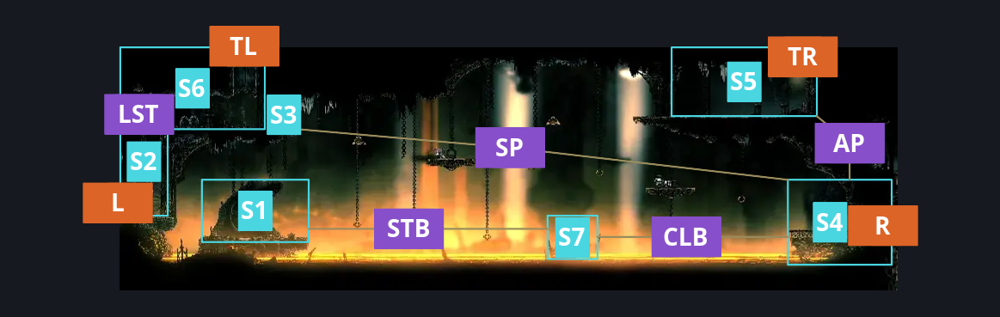
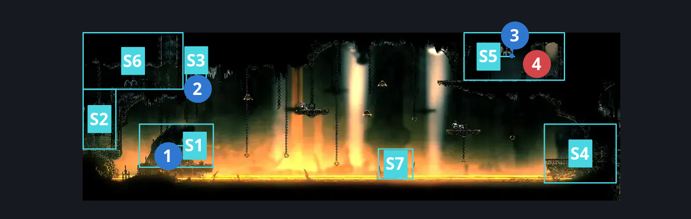
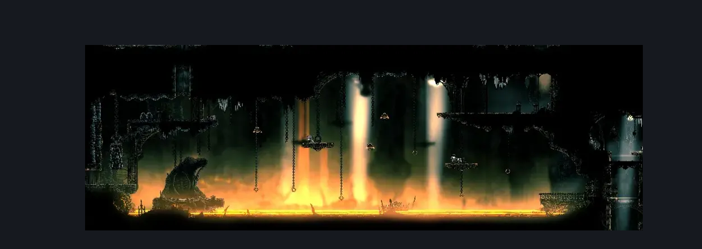

# Underworks Clawline Room (Under_18)

**Game ID:** Under_18

**Contributors:** Rebel, Cry

## Subrooms

| No. | Subroom | Annotated |
| --- | --- | --- |
| S1 | Clawline Statue | ✓ |
| S2 | Blocked Off Corridor Left | ✓ |
| S3 | Shard Bundle Check | ✓ |
| S4 | Main Side Door | ✓ |
| S5 | Arena | ✓ |
| S6 | Blocked Off Corridor Top | ✓ |
| S7 | Metalwork Barge | ✓ |

- **Arena:** Arena activated by Clawline Ring

## Room Transitions

| Alias | Name | From subroom | Destination | Destination alias | Requirements | TODO | Verification | Annotated | Notes |
| --- | --- | --- | --- | --- | --- | --- | --- | --- | --- |
| TR | Top Right | Arena | [Underworks Twelfth Architect (Under_17)](underworks-twelfth-architect.md) | BR | (Clear Underworks Clawline Gauntlet AND (Cling Grip OR Scuttlebrace OR Silk Soar OR (Faydown Cloak AND (Easy Shaman Pogo OR Easy Beast Charge)))) |  | Verified | ✓ |  |
| L | Left | Blocked Off Corridor Left | [Underworks East Shaft (Under_13)](underworks-east-shaft.md) | MR | Nothing. |  | Verified | ✓ |  |
| R | Right | Main Side Door | [Underworks Clawline Entrance (Under_19c)](underworks-clawline-entrance.md) | TL | Invalid |  | Verified | ✓ |  |
| TL | Top Left | Blocked Off Corridor Top | [Underworks Twelfth Architect (Under_17)](underworks-twelfth-architect.md) | BL | Nothing. |  | Verified | ✓ |  |

## Subroom Connections

| Alias | Name | Source | Destination | Requirements | TODO | Verification | Annotated | Notes |
| --- | --- | --- | --- | --- | --- | --- | --- | --- |
| STB | Shrine to Barge | Metalwork Barge | Clawline Statue | Clawline Left x 3  OR Sharpdart x 3 OR Run OR Faydown Cloak OR (Medium Needle Strike AND (Cling Grip Left OR Ledge Grab Left)) OR (Proficient Movement AND Flea Brew AND (Easy Architect Needle Strike OR Architect Slash Left OR Easy Beast Pogo OR ((Easy Flea Brew Stall OR Easy [Wanderer, Reaper] Needle Strike) AND Cling Grip Left) OR (Easy Hunter Pogo AND Cling Grip Left))) |  | Verified | ✓ |  |
| STB | Shrine to Barge | Clawline Statue | Metalwork Barge | Clawline Right x 3 OR (Sharp Dart AND Faydown Cloak AND (Swift Step 2 OR Drifter's Cloak)) |  | Verified | ✓ |  |
| LST | Left Side Travel | Blocked Off Corridor Left | Blocked Off Corridor Top | Silk Soar OR Cling Grip OR Scuttlebrace OR (Faydown Cloak AND (Ledge Grab OR Clawline)) |  | Verified | ✓ |  |
| LST | Left Side Travel | Blocked Off Corridor Top | Blocked Off Corridor Left | Nothing. (Fall) |  | Verified | ✓ |  |
| AP | Arena Path | Main Side Door | Arena | Clawline OR (Faydown Cloak AND (Sharp Dart OR Swift Step 2) AND Ledge Grab AND Enemy Pogo) |  | Verified | ✓ | getting up here without clawline is worthless unless cause the exit needs clawline anyway lmao |
| AP | Arena Path | Arena | Main Side Door | Clawline OR Sharp Dart OR Dash OR Sprint OR Scuttlebrace OR Drifter's Cloak OR (Faydown Cloak AND Ledge Grab) |  | Verified | ✓ |  |
| SP | Shard Path | Shard Bundle Check | Main Side Door | Clawline OR ((Drifter's Cloak OR Progressive Swift Step 2) AND (Easy Enemy Pogo OR (Faydown Cloak AND Sharp Dart))) |  | Verified | ✓ |  |
| SP | Shard Path | Main Side Door | Shard Bundle Check | Clawline OR (Faydown Cloak AND (Sharp Dart OR Swift Step 2) AND Ledge Grab AND Easy Enemy Pogo) |  | Verified | ✓ | same thing as the arena path but you go left at the end instead of right |
| CLB | Clawline to Barge | Main Side Door | Metalwork Barge | run  OR easy [hunter, architect, shaman, beast] pogo OR easy naked pogo OR architect slash left OR easy [witch, architect, beast, wanderer] needle strike OR clawline left OR sharpdart OR drifter's cloak  OR faydown cloak OR flea brew |  | Verified | ✓ | Adding new subroom on the understanding this and the surrounding platforms in the molten steel have been updated to remain after clawline shrine's been picked up. Will adjust if not the case. - Cry 11/24 1:48 CST |
| CLB | Clawline to Barge | Metalwork Barge | Main Side Door | run OR easy beast pogo OR clawline right OR sharpdart OR drifter's cloak OR faydown cloak OR flea brew OR easy [beast, architect] needle strike OR (architect slash right AND ledge grab right) OR easy [voltvessels, plasmium] stall |  | Verified | ✓ |  |

## Check Locations

| No. | Check | Subroom | Requirements | TODO | Verification | Location Type | Annotated | Notes |
| --- | --- | --- | --- | --- | --- | --- | --- | --- |
| 1 | Clawline Pickup | Clawline Statue | Nothing. |  | Verified | collectible | ✓ |  |
| 2 | Underworks: Shard Bundle #2 | Shard Bundle Check | Nothing. |  | Verified | collectible | ✓ |  |
| 3 | Clawline Ring | Arena | Clawline Either |  | Verified | switch | ✓ |  |
| 4 | Underworks Clawline Gauntlet | Arena | Activate Clawline Ring AND Combat Requirements |  | Verified | gauntlet | ✓ |  |
| 5 | import enemies |  |  | TODO | Needs verification |  |  |  |

## Notes

Left and right sides of this room are not connected.

Need confirmation (and changes to the room) on the vanilla approach to Clawline in underworks/underworks-clawline-room
The left and top blocked-off corridors are reachable without Clawline or Faydown, but neither connects to the statue. Its only incoming route is from Main Side Door and requires Clawline or Faydown, creating a cycle when skills stay vanilla. Which connection and requirements are missing 

-Moriko

## Room Images

### Connections

### Checks

### Scene

