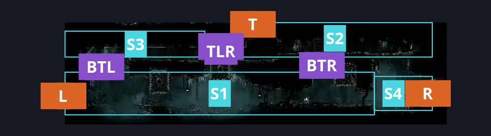
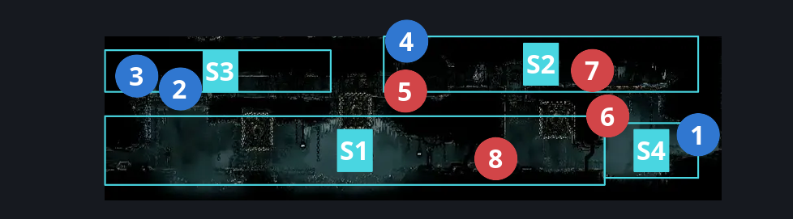
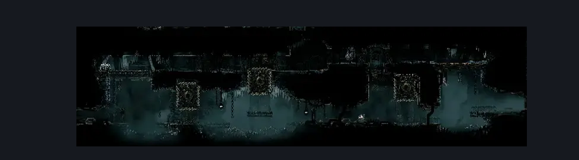

# Underworks Crushing Path (Under_04)

**Game ID:** Under_04

**Contributors:** samupo and Rebel

## Subrooms

| No. | Subroom | Annotated |
| --- | --- | --- |
| S1 | Bottom | ✓ |
| S2 | Top Right | ✓ |
| S3 | Top Left | ✓ |
| S4 | Bottom Right | ✓ |

- **Bottom:** suprisingly it can be routed itemless.

## Room Transitions

| Alias | Name | From subroom | Destination | Destination alias | Requirements | TODO | Verification | Annotated | Notes |
| --- | --- | --- | --- | --- | --- | --- | --- | --- | --- |
| L | left1 | Bottom | [Underworks Saw Shaft (Under_03c)](underworks-saw-shaft.md) | R | nada |  | Verified | ✓ | may be other options |
| T | top1 | Top Right | [Underworks Gym (Under_03d)](underworks-gym.md) | B | Cling Grip Left OR Scuttlebrace OR Silk Soar OR Faydown Cloak |  | Verified | ✓ |  |
| R | right1 | Bottom Right | [Underworks Central Shaft (Under_05)](underworks-central-shaft.md) | BL | Activate Underworks Spinny Walk Room Lever |  | Verified | ✓ | may be other options |

## Subroom Connections

| Alias | Name | Source | Destination | Requirements | TODO | Verification | Annotated | Notes |
| --- | --- | --- | --- | --- | --- | --- | --- | --- |
| BTR | Bottom <> Top Right | Bottom | Top Right | Cling Grip Left OR Silk Soar OR ((Proficient Movement (Crush Block Pogo) OR Faydown Cloak) AND Scuttlebrace) |  | Verified | ✓ |  |
| BTR | Bottom <> Top Right | Top Right | Bottom | Nothing. (Fall) |  | Verified | ✓ |  |
| BTL | Bottom <> Top Left | Bottom | Top Left | (Activate Snapping Floor AND ((Scuttlebrace AND (Clawline Right OR Sharpdart)) OR (Cling Grip Both AND (Dash Right OR Faydown Cloak OR Clawline Right OR Sharpdart OR Easy [Flea Brew] Stall OR Medium [Voltvessels, Plasmium] Stall OR Easy [Architect, Beast] Charge OR Easy [Shaman] Pogo)) OR (Cling Grip Left AND Faydown Cloak))) |  | Verified | ✓ |  |
| BTL | Bottom <> Top Left | Top Left | Bottom | Activate Breakable Ceiling |  | Verified | ✓ |  |
| TLR | Top Left <> Top Right | Top Right | Top Left | Sprint OR Dash Left OR Faydown Cloak OR Drifter's Cloak OR Clawline Left OR Sharpdart OR Scuttlebrace |  | Verified | ✓ |  |
| TLR | Top Left <> Top Right | Top Left | Top Right | Sprint OR Dash Left OR Faydown Cloak OR Drifter's Cloak OR Clawline Left OR Sharpdart OR Scuttlebrace |  | Verified | ✓ |  |
| BBR | Bottom <> Bottom Right | Bottom | Bottom Right | Dash Right OR Clawline Right OR Faydown Cloak OR Spike Pogo OR Easy [Air Bind, Rune Rage, Parry, Pale Nails, Plasmium, Voltvessels, Flea Brew, Flintslate] Stall OR Easy [Architect, Beast] Charge OR Easy [Shaman, Beast, Architect] Pogo OR (Proficient Movement AND Architect Attack Right) OR (Easy Hunter Pogo AND Ledge Grab Right) |  | Verified |  |  |
| BBR | Bottom <> Bottom Right | Bottom Right | Bottom | Nothing. (Fall) |  | Verified |  |  |

## Check Locations

| No. | Check | Subroom | Requirements | TODO | Verification | Location Type | Annotated | Notes |
| --- | --- | --- | --- | --- | --- | --- | --- | --- |
| 1 | Underworks Spinny Walk Room Lever | Bottom Right | Flip Switch Right |  | Verified | switch | ✓ |  |
| 2 | Snapping Floor | Top Left | Break Wall Down |  | Verified | blockade | ✓ |  |
| 3 | Underworks Funny Snappy Platform Shards | Top Left | Ledge Grab Left OR Sprint OR Dash Left OR Faydown Cloak OR Drifter's Cloak OR Clawline Left OR Sharpdart OR Scuttlebrace |  | Verified | collectible | ✓ | is it 14? -platform falling makes it unobtainable itemless, this is fine since the only way to make the platform fall is to get to it. just marking for posterity |
| 4 | Breakable Ceiling | Top Right | Break Wall Up |  | Verified | blockade | ✓ |  |
| 5 | Undersweep 1 | Top Right | free |  | Verified | enemy | ✓ |  |
| 6 | Underpoke 1 | Bottom Right | nada |  | Verified | enemy | ✓ |  |
| 7 | Drapemite 1 | Top Right | zilch |  | Verified | enemy | ✓ |  |
| 8 | Underscrub 1 | Bottom | none |  | Verified | enemy | ✓ |  |

## Room Images

### Connections

### Checks

### Scene

