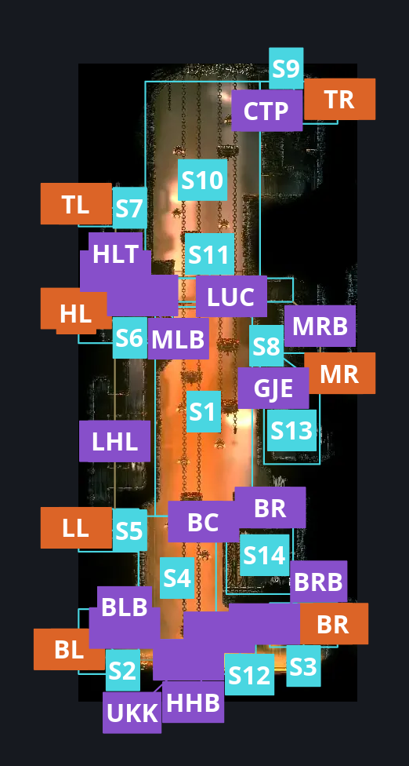
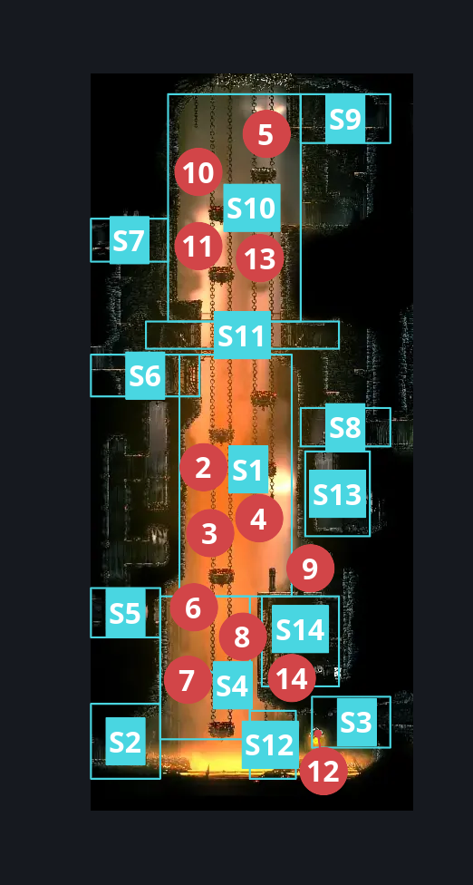
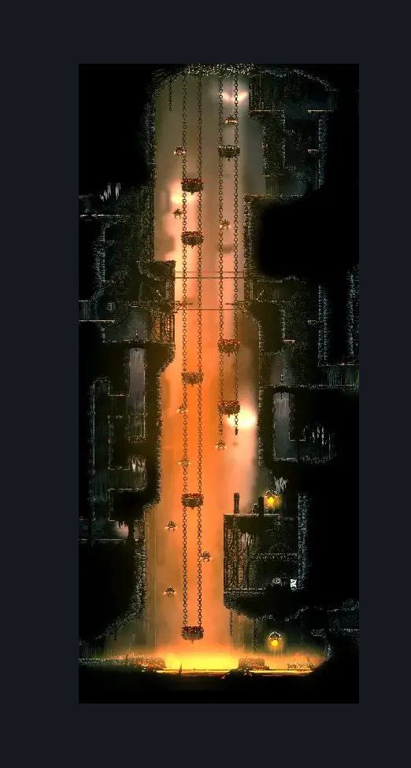

# Underworks East Shaft (Under_13)

**Game ID:** Under_13

**Contributors:** Rebel, Cry

## Subrooms

| No. | Subroom | Annotated |
| --- | --- | --- |
| S1 | Lower Central Shaft | ✓ |
| S2 | Bottom Left Entrance | ✓ |
| S3 | Bottom Right Entrance | ✓ |
| S4 | Bottom | ✓ |
| S5 | Lower Left Entrance | ✓ |
| S6 | High Left Entrance | ✓ |
| S7 | Top Left Entrance | ✓ |
| S8 | Mid Right Entrance | ✓ |
| S9 | Top Right Entrance | ✓ |
| S10 | Upper Central Shaft | ✓ |
| S11 | Bridge | ✓ |
| S12 | The Floor is Hot | ✓ |
| S13 | GBJ | ✓ |
| S14 | Worker's Hub | ✓ |

- **The Floor is Hot:**  

## Room Transitions

| Alias | Name | From subroom | Destination | Destination alias | Requirements | TODO | Verification | Annotated | Notes |
| --- | --- | --- | --- | --- | --- | --- | --- | --- | --- |
| BL | Bottom Left | Bottom Left Entrance | [Underworks Flea Room (Under_21)](underworks-flea-room.md) | R | Nothing. |  | Verified | ✓ |  |
| BR | Bottom Right | Bottom Right Entrance | [Underworks Lava Flow Corridor (Under_19)](underworks-lava-flow-corridor.md) | L | Nothing. |  | Verified | ✓ |  |
| TL | Top Left | Top Left Entrance | [Underworks Lever Spike Corridor (Under_11)](underworks-lever-spike-corridor.md) | R | Nothing. |  | Verified | ✓ |  |
| TR | Top Right | Top Right Entrance | [Underworks Twelfth Architect (Under_17)](underworks-twelfth-architect.md) | FL | Nothing. |  | Verified | ✓ |  |
| HL | High Left | High Left Entrance | [Underworks Ventrica (Under_22)](underworks-ventrica.md) | R | Nothing. |  | Verified | ✓ |  |
| MR | Mid Right | Mid Right Entrance | [Underworks Clawline Room (Under_18)](underworks-clawline-room.md) | L | Nothing. |  | Verified | ✓ |  |
| LL | Low Left | Lower Left Entrance | [Underworks Eastern Gauntlet (Under_10)](underworks-eastern-gauntlet.md) | R | Nothing. |  | Verified | ✓ |  |

## Subroom Connections

| Alias | Name | Source | Destination | Requirements | TODO | Verification | Annotated | Notes |
| --- | --- | --- | --- | --- | --- | --- | --- | --- |
| BC | Bottom-Lower Central | Bottom | Lower Central Shaft | Silk Soar  OR ((Faydown Cloak OR (Clawline Both AND Ledge Grab Right)) AND (Easy Pogo Off Cogwork Underfly)) OR (Drifter's Cloak AND Medium Pogo Off Cogwork Underfly) OR Cling Grip Either OR Easy Scuttlebrace |  | Verified | ✓ |  |
| LHL | Lower Left-High Left | Lower Left Entrance | High Left Entrance | Open Airlock Up AND (Cling Grip Either OR Scuttlebrace) |  | Verified | ✓ |  |
| LHL | Lower Left-High Left | High Left Entrance | Lower Left Entrance | Open Airlock Down |  | Verified | ✓ |  |
| HLT | High Left-Top Left | High Left Entrance | Top Left Entrance | Silk Soar  OR Faydown Cloak  OR Cling Grip Either  OR Easy Scuttlebrace |  | Verified | ✓ |  |
| HLT | High Left-Top Left | Top Left Entrance | High Left Entrance | Nothing. (Fall) |  | Verified | ✓ |  |
| LUC | Lower Central-Upper Central | Lower Central Shaft | Upper Central Shaft | Silk Soar  OR Cling Grip Either  OR Medium Scuttlebrace OR (Easy Scuttlebrace AND Easy Pogo Off Cogwork Underfly) OR (Faydown Cloak AND Medium Pogo Off Cogwork Underfly) |  | Verified | ✓ |  |
| LUC | Lower Central-Upper Central | Upper Central Shaft | Lower Central Shaft | Nothing. (Fall) |  | Verified | ✓ |  |
| BC | Bottom-Lower Central | Lower Central Shaft | Bottom | Nothing. (Fall) |  | Verified | ✓ |  |
| CTP | Upper Central-Top Left | Upper Central Shaft | Top Right Entrance | ((Clawline Right OR Sharpdart) AND Ledge Grab Right)  OR Easy Scuttlebrace  OR Faydown Cloak  OR Cling Grip Either  OR Silk Soar |  | Verified | ✓ |  |
| CTP | Upper Central-Top Left | Top Right Entrance | Upper Central Shaft | Nothing. (Fall) |  | Verified | ✓ |  |
| BLB | Bottom Left <> Bottom | Bottom Left Entrance | Bottom | Ledge Grab Right  OR Faydown Cloak  OR Cling Grip Right OR Easy Shaman Pogo OR Easy Beast Needle Strike OR Easy Scuttlebrace OR ((Medium Flea Brew Stall OR Medium Beast Heal Stall) AND Medium Beast Pogo) OR (Elite Ball Knowledge AND Dash Right AND Medium [Plasmium, Flea Brew] Stall) |  | Verified | ✓ |  |
| BLB | Bottom Left <> Bottom | Bottom | Bottom Left Entrance | Nothing. (Fall) |  | Verified | ✓ |  |
| BRB | Bottom Right <> The Floor is Hot | Bottom Right Entrance | The Floor is Hot | none (falling) |  | Verified | ✓ |  |
| BRB | Bottom Right <> The Floor is Hot | The Floor is Hot | Bottom Right Entrance | Ledge Grab Right  OR Cling Grip Right  OR Faydown Cloak OR ((Easy Beast Needle Strike OR Easy Shaman Pogo) AND (Run OR Flea Brew)) OR ((Clawline Right OR Sharp Dart) AND Hard Scuttlebrace) |  | Verified | ✓ |  |
| HHB | Hot Head Bop | The Floor is Hot | Bottom | ((Ledge Grab Left AND (Run OR Dash Left  OR Sprint  OR Easy Shaman Pogo  OR Easy Architect Charge OR Hard Reaper Needle Strike  OR Flea Brew OR (Proficient Movement  AND Cling Grip Right)))) OR (Proficient Movement AND Run AND Medium Shaman Pogo) OR (Easy Scuttlebrace AND Needle Right) OR Medium Scuttlebrace OR Cling Grip Left OR Easy Beast Charge OR Faydown Cloak OR Sharpdart OR Clawline Left OR Medium [Thread Storm, Rune Rage] Stall OR Easy [Voltvessels, Plasmium] Stall |  | Verified | ✓ |  |
| HHB | Hot Head Bop | Bottom | The Floor is Hot | None (Falling) |  | Verified | ✓ |  |
| MRB | Mid Right <> Bridge | Mid Right Entrance | Bridge | (Activate Underworks East Bridge Switch AND (Cling Grip Right OR Faydown Cloak OR Medium Scuttlebrace)) |  | Verified | ✓ |  |
| MRB | Mid Right <> Bridge | Bridge | Mid Right Entrance | Activate Underworks East Bridge Switch |  | Verified | ✓ |  |
| MLB | Mid Left <> Bridge | High Left Entrance | Bridge | Activate Underworks East Bridge Switch |  | Verified | ✓ |  |
| MLB | Mid Left <> Bridge | Bridge | High Left Entrance | Activate Underworks East Bridge Switch |  | Verified | ✓ |  |
| IB1 | Invalid Bridge 1 | Upper Central Shaft | Bridge | Invalid |  | Verified |  | redundant connection to emphasize for logic that this is not allowed. |
| IB2 | Invalid Bridge 2 | Lower Central Shaft | Bridge | Invalid |  | Verified |  | redundant connection to emphasize for logic that this is not allowed. |
| UKK | Under Kleaver's Kiln | The Floor is Hot | Bottom Left Entrance | Clawline Left OR Sharpdart OR Drifter's Cloak OR (Dash Left AND (Easy Architect Needle Strike OR Easy Beast Pogo)) OR (Proficient Movement AND Run AND Dash Left AND (Easy Voltvessels Stall OR Medium Plasmium Stall)) OR (Proficient Movement AND Medium [Hunter, Architect] Pogo AND Medium Voltvessels Stall) |  | Verified | ✓ |  |
| UKK | Under Kleaver's Kiln | Bottom Left Entrance | The Floor is Hot | Clawline Right  OR Sharpdart OR  (Drifter's Cloak  AND (Easy Beast Pogo  OR (Easy Architect Needle Strike AND Dash Right)  OR (Proficient Movement AND Dash Right) OR Easy [Plasmium, Flintslate] Stall)) |  | Verified | ✓ |  |
| GJE | GBJ Escape | GBJ | Mid Right Entrance | Cling Grip Either  OR Easy Scuttlebrace OR Silk Soar |  | Verified | ✓ |  |
| GJE | GBJ Escape | Mid Right Entrance | GBJ | None (Falling) |  | Verified | ✓ |  |
| BR | Break Room | Lower Central Shaft | Worker's Hub | None (Falling) |  | Verified | ✓ |  |
| BR | Break Room | Worker's Hub | Lower Central Shaft | Faydown Cloak  OR Cling Grip Either OR Easy Scuttlebrace OR Silk Soar |  | Verified | ✓ |  |

## Check Locations

| No. | Check | Subroom | Requirements | TODO | Verification | Location Type | Annotated | Notes |
| --- | --- | --- | --- | --- | --- | --- | --- | --- |
| 1 | Underworks East Bridge Switch | Mid Right Entrance | Flip Switch Left |  | Verified | switch |  |  |
| 2 | Cogwork Underfly 1 | Lower Central Shaft | none |  | Verified | enemy | ✓ |  |
| 3 | Cogwork Underfly 2 | Lower Central Shaft | none |  | Verified | enemy | ✓ |  |
| 4 | Cogwork Underfly 3 | Lower Central Shaft | none |  | Verified | enemy | ✓ |  |
| 5 | Cogwork Underfly 4 | Upper Central Shaft | none |  | Verified | enemy | ✓ |  |
| 6 | Cogwork Underfly 5 | Bottom | none |  | Verified | enemy | ✓ |  |
| 7 | Cogwork Underfly 6 | Bottom | none |  | Verified | enemy | ✓ |  |
| 8 | Cogwork Underfly 7 | Bottom | none |  | Verified | enemy | ✓ |  |
| 9 | Cogwork Hauler 1 | Lower Central Shaft | none |  | Verified | enemy | ✓ |  |
| 10 | Cogwork Underfly 8 | Upper Central Shaft | none |  | Verified | enemy | ✓ |  |
| 11 | Cogwork Underfly 9 | Upper Central Shaft | none |  | Verified | enemy | ✓ |  |
| 12 | Cogwork Hauler 2 | Bottom Right Entrance | none |  | Verified | enemy | ✓ |  |
| 13 | Cogwork Underfly 10 | Upper Central Shaft | none |  | Verified | enemy | ✓ |  |
| 14 | Underscrub 1 | Worker's Hub | none |  | Verified | enemy | ✓ |  |

## Room Images

### Connections

### Checks

### Scene

