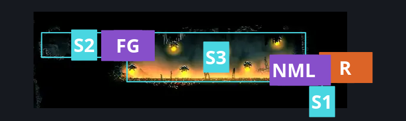
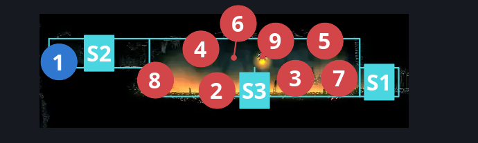

# Underworks Flea Room (Under_21)

**Game ID:** Under_21

**Contributors:** Rebel

## Subrooms

| No. | Subroom | Annotated |
| --- | --- | --- |
| S1 | Entrance | ✓ |
| S2 | Flea | ✓ |
| S3 | Hauler Dropzone | ✓ |

## Room Transitions

| Alias | Name | From subroom | Destination | Destination alias | Requirements | TODO | Verification | Annotated | Notes |
| --- | --- | --- | --- | --- | --- | --- | --- | --- | --- |
| R | right1 | Entrance | [Underworks East Shaft (Under_13)](underworks-east-shaft.md) | BL | Nothing. |  | Verified | ✓ |  |

## Subroom Connections

| Alias | Name | Source | Destination | Requirements | TODO | Verification | Annotated | Notes |
| --- | --- | --- | --- | --- | --- | --- | --- | --- |
| FG | Flea Get | Hauler Dropzone | Flea | Ledge Grab Left OR Easy Pogo Off Cogwork Hauler  OR Cling Grip Left OR Easy Scuttlebrace  OR Faydown Cloak  OR Silk Soar OR (Elite Ball Knowledge AND Dash Either AND (Medium [Flea Brew, Voltvessels, Plasmium] Stall OR Medium [Air Bind, Thread Storm, Rune Rage] Stall OR Easy Beast Pogo OR Clawline Right OR Sharpdart OR Easy Reaper Needle Strike)) OR Easy Beast Needle Strike OR Easy Shaman Pogo |  | Verified | ✓ |  |
| FG | Flea Get | Flea | Hauler Dropzone | Nothing. (Fall) |  | Verified | ✓ |  |
| NML | No Man's Land | Entrance | Hauler Dropzone | Nothing. |  | Verified | ✓ |  |
| NML | No Man's Land | Hauler Dropzone | Entrance | Nothing. |  | Verified | ✓ |  |

## Check Locations

| No. | Check | Subroom | Requirements | TODO | Verification | Location Type | Annotated | Notes |
| --- | --- | --- | --- | --- | --- | --- | --- | --- |
| 1 | Underworks: Flea #1 | Flea | Nothing. |  | Verified | collectible | ✓ |  |
| 2 | Cogwork Hauler 4 | Hauler Dropzone | Nothing. |  | Verified | enemy | ✓ |  |
| 3 | Cogwork Hauler 5 | Hauler Dropzone |  |  | Verified | enemy | ✓ |  |
| 4 | Cogwork Hauler 6 | Hauler Dropzone |  |  | Verified | enemy | ✓ |  |
| 5 | Cogwork Hauler 7 | Hauler Dropzone |  |  | Verified | enemy | ✓ |  |
| 6 | Cogwork Hauler 8 | Hauler Dropzone |  |  | Verified | enemy | ✓ |  |
| 7 | Cogwork Hauler 9 | Hauler Dropzone |  |  | Verified | enemy | ✓ |  |
| 8 | Cogwork Hauler 10 | Hauler Dropzone |  |  | Verified | enemy | ✓ |  |
| 9 | Cogwork Hauler 11 | Hauler Dropzone |  |  | Verified | enemy | ✓ |  |

## Room Images

### Connections

### Checks

### Scene

