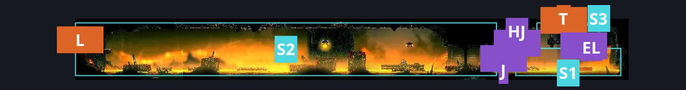
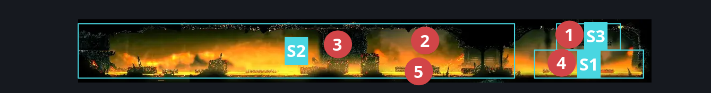

# Underworks Lava Flow Corridor (Under_19)

**Game ID:** Under_19

**Contributors:** Rebel, Cry

## Subrooms

| No. | Subroom | Annotated |
| --- | --- | --- |
| S1 | Right Exit | ✓ |
| S2 | Main | ✓ |
| S3 | Right Exit Hangoff | ✓ |

## Room Transitions

| Alias | Name | From subroom | Destination | Destination alias | Requirements | TODO | Verification | Annotated | Notes |
| --- | --- | --- | --- | --- | --- | --- | --- | --- | --- |
| T | top1 | Right Exit | [Underworks Clawline Entrance (Under_19c)](underworks-clawline-entrance.md) | B | Nothing. |  | Verified | ✓ |  |
| L | left1 | Main | [Underworks East Shaft (Under_13)](underworks-east-shaft.md) | BR | Nothing. |  | Verified | ✓ |  |

## Subroom Connections

| Alias | Name | Source | Destination | Requirements | TODO | Verification | Annotated | Notes |
| --- | --- | --- | --- | --- | --- | --- | --- | --- |
| J | Jump | Main | Right Exit | Clawline Right  OR Cling Grip Left OR Sharp Dart  OR Dash Right OR Faydown Cloak  OR Drifter's Cloak  OR Scuttlebrace OR Run OR Flea Brew OR Easy [Hunter, Beast, Architect, Shaman, Reaper, Witch] Pogo OR Easy Naked Pogo OR Easy [Architect, Beast, Wanderer, Witch] Needle Strike OR Easy [Voltvessels, Plasmium, Flintslate] Stall OR Easy [Thread Storm, Cross Stitch, Pale Nails] Stall OR Medium [Rune Rage, Air Bind] Stall OR Easy [Witch, Beast] Heal Stall |  | Verified | ✓ |  |
| J | Jump | Right Exit | Main | Clawline Left OR Sharp Dart  OR Dash Left OR Faydown Cloak  OR Drifter's Cloak  OR Scuttlebrace OR Run OR Flea Brew OR Easy [Hunter, Beast, Architect, Shaman] Pogo OR (Easy [Witch, Reaper] Pogo AND (Ledge Grab Left OR Cling Grip Left)) OR Easy Naked Pogo OR Easy [Architect, Beast, Wanderer] Needle Strike OR Medium Witch Needle Strike OR Easy [Voltvessels, Plasmium, Flintslate] Stall OR Easy [Thread Storm, Cross Stitch, Pale Nails] Stall OR Medium [Rune Rage, Air Bind] Stall OR Easy [Witch, Beast] Heal Stall |  | Verified | ✓ |  |
| EL | Exit Lift | Right Exit | Right Exit Hangoff | Faydown Cloak OR Cling Grip Right OR (Medium Scuttlebrace AND (Cling Grip Left OR Ledge Grab Left)) |  | Verified | ✓ |  |
| EL | Exit Lift | Right Exit Hangoff | Right Exit | none (falling) |  | Verified | ✓ |  |
| HJ | Hangoff Jump | Main | Right Exit Hangoff | Cling Grip Left AND (Clawline Right OR Sharpdart OR (Easy Beast Needle Strike AND (Dash Right OR Drifter's Cloak)) OR (Easy Architect Needle Strike AND Dash Right AND (Ledge Grab Right OR Cling Grip Right)) OR (Medium Architect Needle Strike AND Drifter's cloak) OR (Easy Shaman Pogo AND (Ledge Grab Right OR Cling Grip Right) AND (Dash Right OR Drifter's Cloak)) OR (Easy Shaman Pogo AND Drifter's Cloak AND Dash Right)) |  | Verified | ✓ | Redudant Inverse, Shared Connections with Jump |

## Check Locations

| No. | Check | Subroom | Requirements | TODO | Verification | Location Type | Annotated | Notes |
| --- | --- | --- | --- | --- | --- | --- | --- | --- |
| 1 | Undersweep 1 | Right Exit Hangoff | none |  | Verified | enemy | ✓ |  |
| 2 | Cogwork Underfly 1 | Main | none |  | Verified | enemy | ✓ |  |
| 3 | Cogwork Hauler 1 | Main | none |  | Verified | enemy | ✓ |  |
| 4 | Cogwork Hauler 2 | Right Exit | none |  | Verified | enemy | ✓ |  |
| 5 | Underscrub 1 | Main | none |  | Verified | enemy | ✓ |  |

## Room Images

### Connections

### Checks

### Scene

