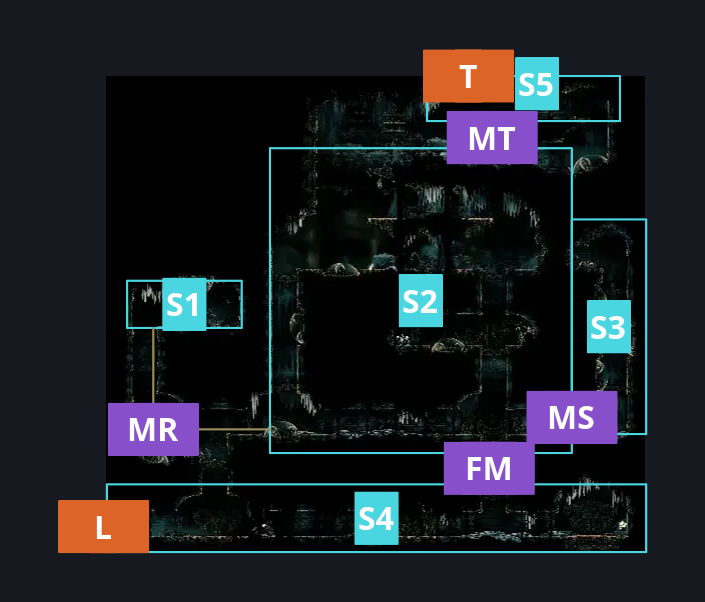
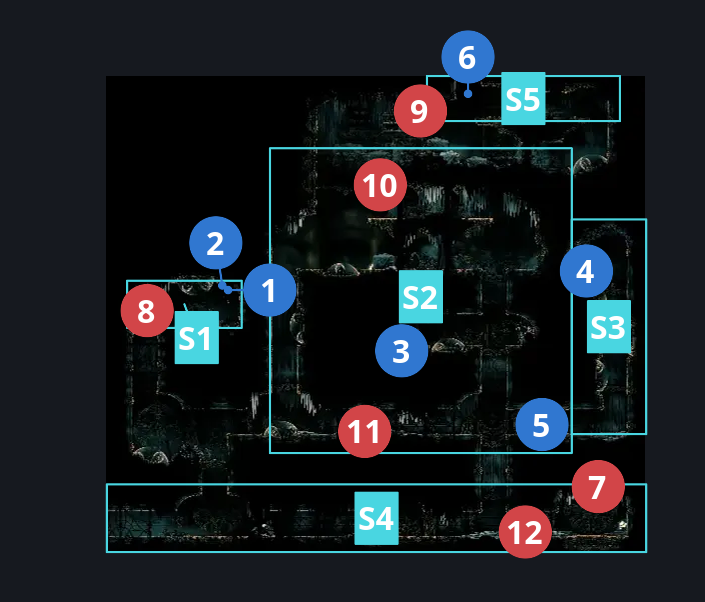
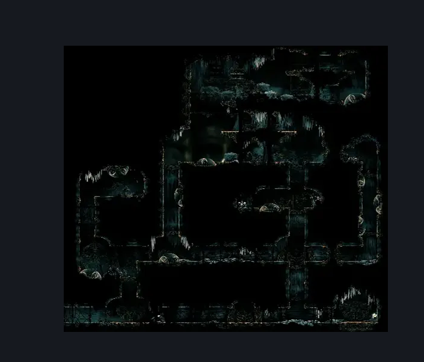

# Underworks Outside Choral Chambers (Under_07c)

**Game ID:** Under_07c

**Contributors:** samupo and Rebel

## Subrooms

| No. | Subroom | Annotated |
| --- | --- | --- |
| S1 | Rosary | ✓ |
| S2 | Main | ✓ |
| S3 | Frayed String | ✓ |
| S4 | Floor | ✓ |
| S5 | Top Exit | ✓ |

## Room Transitions

| Alias | Name | From subroom | Destination | Destination alias | Requirements | TODO | Verification | Annotated | Notes |
| --- | --- | --- | --- | --- | --- | --- | --- | --- | --- |
| L | left2 | Floor | [Underworks Shaft (Under_02)](underworks-shaft.md) | R4 | none |  | Verified | ✓ |  |
| T | top1 | Top Exit | [Choral Chambers Outisde Underworks (Under_07b)](../choral-chambers/choral-chambers-outisde-underworks.md) | B | activate Switch Outside Choral Chambers |  | Verified | ✓ |  |

## Subroom Connections

| Alias | Name | Source | Destination | Requirements | TODO | Verification | Annotated | Notes |
| --- | --- | --- | --- | --- | --- | --- | --- | --- |
| FM | Floor <> Main | Floor | Main | Cling Grip Either OR Scuttlebrace OR Silk Soar |  | Verified | ✓ |  |
| FM | Floor <> Main | Main | Floor | Nothing. (fall) |  | Verified | ✓ |  |
| MS | Main <> String | Main | Frayed String | Activate Fuckass Room Wall AND (Cling Grip Both OR Silk Soar OR (Easy Scuttlebrace AND Spike Pogo) OR (Cling Grip Either AND (Spike Pogo OR Faydown Cloak))) |  | Verified | ✓ |  |
| MS | Main <> String | Frayed String | Main | Activate Fuckass Room Wall |  | Verified | ✓ |  |
| MR | Main <> Rosary | Main | Rosary | Cling Grip Left OR Easy Scuttlebrace OR (Cling Grip Right AND Faydown Cloak) |  | Verified | ✓ |  |
| MR | Main <> Rosary | Rosary | Main | Nothing. (Fall) |  | Verified | ✓ |  |
| MT | Main <> Top | Main | Top Exit | Open Airlock Up AND (Silk Soar OR Faydown Cloak OR Cling Grip Right OR Easy Scuttlebrace) |  | Verified | ✓ |  |
| MT | Main <> Top | Top Exit | Main | Nothing. (Fall) |  | Verified | ✓ |  |

## Check Locations

| No. | Check | Subroom | Requirements | TODO | Verification | Location Type | Annotated | Notes |
| --- | --- | --- | --- | --- | --- | --- | --- | --- |
| 1 | Underworks The Other No-Fly-Zone Rosary String | Rosary | nothing |  | Verified | collectible | ✓ |  |
| 2 | Underworks No-Fly-Zone Rosary String | Rosary | nada |  | Verified | collectible | ✓ |  |
| 3 | Underworks Sawblade's Hard Earned Shell Shards | Main | cling grip Either AND (dash Left OR clawline Left OR sharpdart) |  | Verified | collectible | ✓ |  |
| 4 | Underworks Fan Insured Rosary String | Frayed String | Free |  | Verified | collectible | ✓ |  |
| 5 | Fuckass Room Wall | Main | Break Wall Right |  | Verified | blockade | ✓ |  |
| 6 | Switch Outside Choral Chambers | Top Exit | flip switch up |  | Verified | switch | ✓ |  |
| 7 | Drapefly 1 | Floor | free |  | Verified | enemy | ✓ |  |
| 8 | Drapefly 2 | Rosary | Nada |  | Verified | enemy | ✓ |  |
| 9 | Drapefly 3 | Top Exit | zilch |  | Verified | enemy | ✓ |  |
| 10 | Drapefly 4 | Main | nothing |  | Verified | enemy | ✓ |  |
| 11 | Drapemite 1 | Main | nothing |  | Verified | enemy | ✓ |  |
| 12 | Underscrub 1 | Floor | free |  | Verified | enemy | ✓ |  |

## Notes

floor connection that is seemingly not in game

## Room Images

### Connections

### Checks

### Scene

