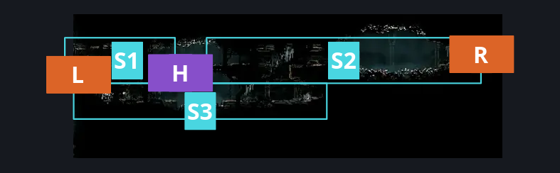
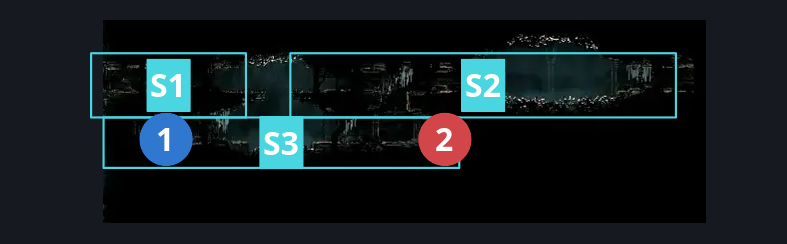
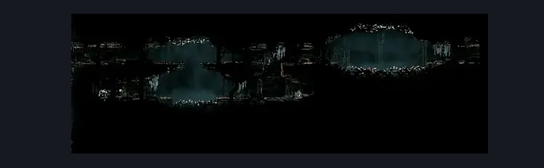

# Underworks Saw Intro (Under_03b)

**Game ID:** Under_03b

**Contributors:** samupo and Rebel

## Subrooms

| No. | Subroom | Annotated |
| --- | --- | --- |
| S1 | Left | ✓ |
| S2 | Right | ✓ |
| S3 | Bottom | ✓ |

## Room Transitions

| Alias | Name | From subroom | Destination | Destination alias | Requirements | TODO | Verification | Annotated | Notes |
| --- | --- | --- | --- | --- | --- | --- | --- | --- | --- |
| L | left1 | Left | [Underworks Shaft (Under_02)](underworks-shaft.md) | R2 | none |  | Verified | ✓ |  |
| R | right1 | Right | [Underworks Saw Shaft (Under_03c)](underworks-saw-shaft.md) | L2 | none |  | Verified | ✓ |  |

## Subroom Connections

| Alias | Name | Source | Destination | Requirements | TODO | Verification | Annotated | Notes |
| --- | --- | --- | --- | --- | --- | --- | --- | --- |
| H | Horizontal | Left | Right | ledge grab Right OR dash Right OR clawline Right OR Sharpdart OR Easy Architect Charge OR Easy Beast Pogo |  | Verified | ✓ |  |
| H | Horizontal | Right | Left | ledge grab Left OR dash Left OR clawline Left OR Sharpdart OR Easy Architect Charge OR Easy Beast Pogo |  | Verified | ✓ |  |
| V1 | Vertical | Right | Bottom | Nothing. (Fall) |  | Verified |  |  |
| V1 | Vertical | Bottom | Right | Cling Grip Right OR Scuttlebrace OR Faydown Cloak OR Silk Soar |  | Verified |  |  |
| V2 | Vertical 2 | Left | Bottom | Nothing. (Fall) |  | Verified |  |  |
| V2 | Vertical 2 | Bottom | Left | (Faydown Cloak AND (Ledge Grab Left OR Cling Grip Left)) |  | Verified |  |  |

## Check Locations

| No. | Check | Subroom | Requirements | TODO | Verification | Location Type | Annotated | Notes |
| --- | --- | --- | --- | --- | --- | --- | --- | --- |
| 1 | Underworks Sawblade Scraps Pile | Bottom | none |  | Verified | collectible | ✓ | Shell Shards |
| 2 | Underscrub 1 | Bottom | nada |  | Verified | enemy | ✓ |  |

## Room Images

### Connections

### Checks

### Scene

