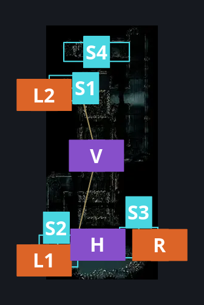
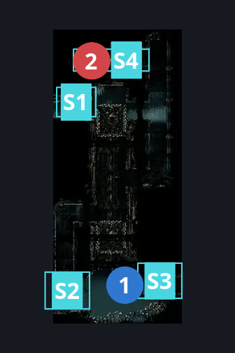
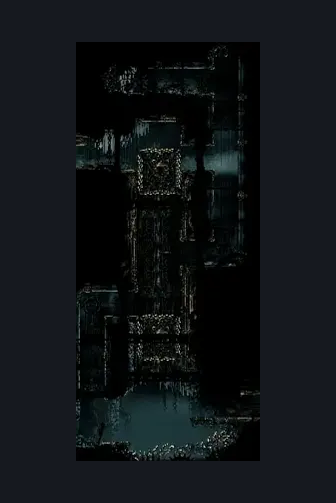

# Underworks Saw Shaft (Under_03c)

**Game ID:** Under_03c

**Contributors:** samupo and Rebel

## Subrooms

| No. | Subroom | Annotated |
| --- | --- | --- |
| S1 | Top | ✓ |
| S2 | Left Entry | ✓ |
| S3 | Right Entry | ✓ |
| S4 | The Mite Guy | ✓ |

## Room Transitions

| Alias | Name | From subroom | Destination | Destination alias | Requirements | TODO | Verification | Annotated | Notes |
| --- | --- | --- | --- | --- | --- | --- | --- | --- | --- |
| L2 | left1 | Top | [Underworks Saw Intro (Under_03b)](underworks-saw-intro.md) | R | none |  | Verified | ✓ |  |
| L1 | left2 | Left Entry | [Underworks Shard Room (Under_03)](underworks-shard-room.md) | R | none |  | Verified | ✓ |  |
| R | right1 | Right Entry | [Underworks Crushing Path (Under_04)](underworks-crushing-path.md) | L | none |  | Verified | ✓ |  |

## Subroom Connections

| Alias | Name | Source | Destination | Requirements | TODO | Verification | Annotated | Notes |
| --- | --- | --- | --- | --- | --- | --- | --- | --- |
| H | Horizontal | Left Entry | Right Entry | dash right OR clawline right OR Sharpdart OR faydown cloak OR Easy Architect Charge OR Easy Beast Charge OR Easy Beast Pogo OR ((Proficient Movement OR Medium Flintslate Stall OR Easy Voltvessels Stall OR Easy Plasmium Stall OR Flea Brew OR Spike Pogo OR Drifter's Cloak) AND Ledge Grab right) |  | Verified | ✓ |  |
| H | Horizontal | Right Entry | Left Entry | dash left OR clawline left OR Sharpdart OR faydown cloak OR spike pogo OR drifter's cloak OR Easy Architect Charge OR Easy Beast Charge OR Easy Beast Pogo OR Easy Voltvessels Stall OR Easy Plasmium Stall OR Easy Flea Brew Stall OR Flea Brew OR ((Proficient Movement OR Medium Flintslate Stall) AND Ledge Grab left) |  | Verified | ✓ |  |
| V | Vertical | Top | Left Entry | nothing |  | Verified | ✓ | falling |
| V | Vertical | Left Entry | Top | cling grip left OR easy Scuttlebrace OR (cling grip right AND (faydown OR silk soar OR easy shaman pogo)) |  | Verified | ✓ |  |
| MDR | KILL!!! MURDER!!! | Top | The Mite Guy | Cling Grip Either OR Easy Scuttlebrace OR Silk Soar OR (Faydown Cloak AND Ledge Grab Left AND Easy Air Bind Stall) |  | Verified |  |  |

## Check Locations

| No. | Check | Subroom | Requirements | TODO | Verification | Location Type | Annotated | Notes |
| --- | --- | --- | --- | --- | --- | --- | --- | --- |
| 1 | Snapping Floor | Right Entry | Break Wall Down |  | Verified | blockade | ✓ |  |
| 2 | Drapemite 1 | The Mite Guy | nada |  | Verified | enemy | ✓ |  |

## Room Images

### Connections

### Checks

### Scene

