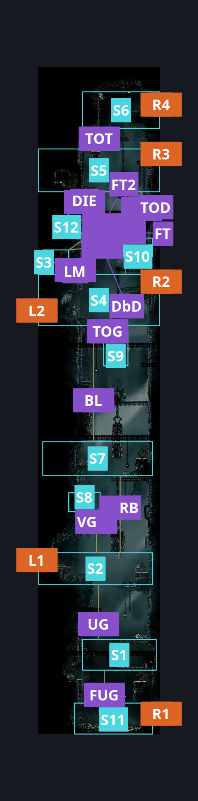
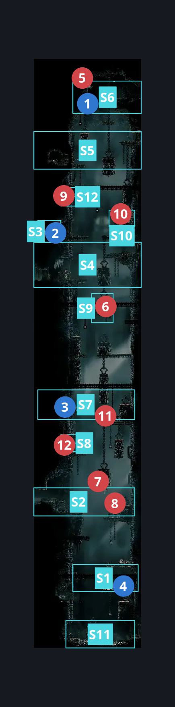
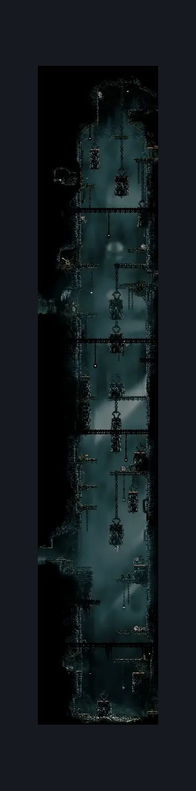

# Underworks Shaft (Under_02)

**Game ID:** Under_02

**Contributors:** samupo and Rebel

## Subrooms

| No. | Subroom | Annotated |
| --- | --- | --- |
| S1 | Underground | ✓ |
| S2 | Bottom | ✓ |
| S3 | Lever | ✓ |
| S4 | Mid | ✓ |
| S5 | Top | ✓ |
| S6 | Overtop | ✓ |
| S7 | Bottom Lever | ✓ |
| S8 | This Guy | ✓ |
| S9 | That Guy | ✓ |
| S10 | This Other Guy Too | ✓ |
| S11 | Underground Entrance | ✓ |
| S12 | This Last Guy As Well | ✓ |

## Room Transitions

| Alias | Name | From subroom | Destination | Destination alias | Requirements | TODO | Verification | Annotated | Notes |
| --- | --- | --- | --- | --- | --- | --- | --- | --- | --- |
| R4 | right1 | Overtop | [Underworks Outside Choral Chambers (Under_07c)](underworks-outside-choral-chambers.md) | L | none |  | Verified | ✓ |  |
| R3 | right2 | Top | [Underworks Western Gauntlet (Under_07)](underworks-western-gauntlet.md) | L | none |  | Verified | ✓ |  |
| R2 | right3 | Mid | [Underworks Saw Intro (Under_03b)](underworks-saw-intro.md) | L | none |  | Verified | ✓ |  |
| L2 | left3 | Mid | [Underworks Map Room (Under_16)](underworks-map-room.md) | R | none |  | Verified | ✓ |  |
| L1 | left1 | Bottom | [Broken Elevator (Under_01b)](broken-elevator.md) | R | Activate Underworks Elevator Entrance Lever IN Broken Elevator |  | Verified | ✓ |  |
| R1 | right4 | Underground Entrance | [Underworks Delver's Drill (Under_14)](underworks-delver-s-drill.md) | L | Activate Underground Entrance Lever |  | Verified | ✓ |  |

## Subroom Connections

| Alias | Name | Source | Destination | Requirements | TODO | Verification | Annotated | Notes |
| --- | --- | --- | --- | --- | --- | --- | --- | --- |
| TOT | Top to Overtop | Overtop | Top | Nothing. (Fall) |  | Verified | ✓ |  |
| TOT | Top to Overtop | Top | Overtop | cling grip Left OR faydown cloak OR Silk Soar OR  (Activate Snapping Floor AND (Cling Grip Right)) |  | Verified | ✓ |  |
| FT | Falling from Top | Top | Mid | Activate Platform Fall Lever |  | Verified | ✓ | falling |
| FT | Falling from Top | Mid | Top | Silk Soar OR Cling Grip Right OR  (Medium Scuttlebrace AND  (Faydown Cloak AND Ledge Grab Right)) OR  (Cling Grip Left AND Run Left AND Faydown Cloak) |  | Verified | ✓ |  |
| FT2 | Falling from Top 2 | Top | Lever | none (Fall) |  | Verified | ✓ |  |
| FT2 | Falling from Top 2 | Lever | Top | Silk Soar OR Cling Grip Right OR  (Medium Scuttlebrace AND  (Faydown Cloak AND Ledge Grab Right)) OR  (Cling Grip Left AND Faydown Cloak) |  | Verified | ✓ |  |
| TOD | This Other Dude | Top | This Other Guy Too | Nothing (Fall, aggro enemy) |  | Verified | ✓ |  |
| DbD | This Other Dude But Different | Lever | This Other Guy Too | Attack Up OR  (Jump AND  (Attack Right OR Clawline Right)) OR  Ledge Grab Right OR Cling Grip Right OR Faydown Cloak OR Silk Soar |  | Verified | ✓ | can be aggro'd by jumping into the platform without jumping onto it. can also be hit from below. |
| LM | Lever to Mid | Mid | Lever | Activate Platform Fall Lever AND  (Cling Grip Right OR Ledge Grab Right OR Faydown Cloak OR Silk Soar OR  (Run Left AND (Cling Grip Left OR Ledge Grab Left))) |  | Verified | ✓ |  |
| LM | Lever to Mid | Lever | Mid | Activate Platform Fall Lever |  | Verified | ✓ |  |
| BL | Reaching Bottom Lever | Mid | Bottom Lever | Nothing. (Fall) |  | Verified | ✓ |  |
| BL | Reaching Bottom Lever | Bottom Lever | Mid | Activate First Ascent Lever AND  (silk soar OR Cling Grip Right OR Medium Scuttlebrace OR  (Cling Grip Left AND Faydown Cloak)) | TODO | Verified | ✓ | TODO, probably doable with more than faydown. |
| TOG | That One Guy | Mid | That Guy | Nothing (Fall, aggro enemy) |  | Verified | ✓ |  |
| RB | Reaching Bottom | Bottom Lever | Bottom | Nothing. (Fall) |  | Verified | ✓ |  |
| RB | Reaching Bottom | Bottom | Bottom Lever | Silk Soar OR Cling Grip Both OR (Faydown Cloak AND Cling Grip Either) OR (Hard [Rune Rage, Thread storm, Air Bind] Stall AND Cling Grip Left) OR ((Drifter's CLoak OR Clawline Left OR Sharpdart OR Dash Left OR (Proficient Movement AND Run)) AND Cling Grip Right) OR (Medium Scuttlebrace AND (Faydown Cloak OR Clawline Left OR Sharpdart OR Drifter's Cloak OR Medium [Shaman] Pogo OR Easy [Architect] Charge OR Medium [Flea Brew, Plasmium] Stall)) |  | Verified | ✓ |  |
| VG | Void Guy | Bottom | This Guy | Silk Soar OR Cling Grip Both OR  (Faydown Cloak AND Cling Grip Either) OR  (Hard [Rune Rage, Thread storm, Air Bind] Stall AND Cling Grip Left) OR  ((Drifter's CLoak OR Clawline Left OR Sharpdart OR Dash Left OR  (Proficient Movement AND Run)) AND Cling Grip Right) OR  (Medium Scuttlebrace AND (Faydown Cloak OR Clawline Left OR Sharpdart OR Drifter's Cloak OR Medium [Shaman] Pogo OR Easy [Architect] Charge OR Medium [Flea Brew, Plasmium] Stall)) | TODO | Verified | ✓ | TODO< definitely more stall variants that work here but i cant get them to. |
| VG | Void Guy | This Guy | Bottom | Nothing (Fall) |  | Verified | ✓ |  |
| UG | Underground | Bottom | Underground | Activate Platform Fall Lever |  | Verified | ✓ |  |
| UG | Underground | Underground | Bottom | Activate Platform Fall Lever AND  (Silk Soar OR Cling Grip Left OR  (Cling Grip Right AND  (Ledge Grab Left OR  (Faydown Cloak AND  (Dash Left OR Clawline Left))))) |  | Verified | ✓ |  |
| FUG | From Underground | Underground Entrance | Underground | (Activate Underground Entrance Lever AND  ((Dash Both AND  (cling grip left OR ledge grab left) AND  (cling grip right OR ledge grab right)) OR  (Clawline Both AND Cling Grip Left) OR  (Faydown Cloak AND Cling Grip Either))) |  | Verified | ✓ |  |
| FUG | From Underground | Underground | Underground Entrance | Activate Underground Entrance Lever (Fall) |  | Verified | ✓ |  |
| DIE | DIE! | Top | This Last Guy As Well | Nothing (Fall, aggro enemy) |  | Verified | ✓ |  |

## Check Locations

| No. | Check | Subroom | Requirements | TODO | Verification | Location Type | Annotated | Notes |
| --- | --- | --- | --- | --- | --- | --- | --- | --- |
| 1 | Snapping Floor | Overtop | Break Wall Down |  | Verified | blockade | ✓ |  |
| 2 | Platform Fall Lever | Lever | Flip Switch Left |  | Verified | switch | ✓ |  |
| 3 | First Ascent Lever | Bottom Lever | Flip Switch Left |  | Verified | switch | ✓ |  |
| 4 | Underground Entrance Lever | Underground | Flip Switch Right |  | Verified | switch | ✓ |  |
| 5 | Underloft 1 | Overtop | nothing |  | Verified | enemy | ✓ |  |
| 6 | Underpoke 1 | That Guy | zilch |  | Verified | enemy | ✓ |  |
| 7 | Underloft 2 | Bottom | none |  | Verified | enemy | ✓ |  |
| 8 | Underpoke 2 | Bottom | free |  | Verified | enemy | ✓ |  |
| 9 | Underpoke 3 | This Last Guy As Well | nothing |  | Verified | enemy | ✓ |  |
| 10 | Underworker 1 | This Other Guy Too | free |  | Verified | enemy | ✓ |  |
| 11 | Underworker 2 | Bottom Lever | nada |  | Verified | enemy | ✓ |  |
| 12 | Void Mass 1 | This Guy | Black Thread World Spawn |  | Verified | enemy | ✓ |  |

## Room Images

### Connections

### Checks

### Scene

