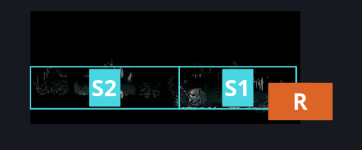
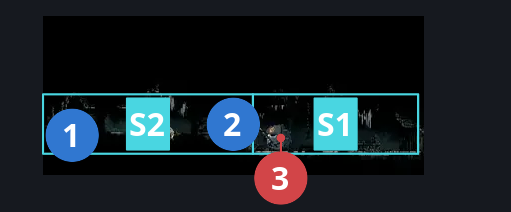
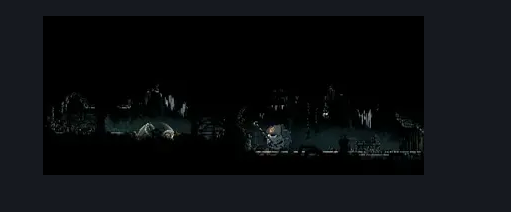

# Underworks Shard Room (Under_03)

**Game ID:** Under_03

**Contributors:** samupo and Rebel

## Subrooms

| No. | Subroom | Annotated |
| --- | --- | --- |
| S1 | Entry | ✓ |
| S2 | Shards | ✓ |

## Room Transitions

| Alias | Name | From subroom | Destination | Destination alias | Requirements | TODO | Verification | Annotated | Notes |
| --- | --- | --- | --- | --- | --- | --- | --- | --- | --- |
| R | right1 | Entry | [Underworks Saw Shaft (Under_03c)](underworks-saw-shaft.md) | L1 | none |  | Verified | ✓ |  |

## Subroom Connections

No subroom connections defined.

## Check Locations

| No. | Check | Subroom | Requirements | TODO | Verification | Location Type | Annotated | Notes |
| --- | --- | --- | --- | --- | --- | --- | --- | --- |
| 1 | Underworks Big Guy's Shard Stache | Shards | Activate Underworks Big Guy's Personal Vault Door | TODO | Verified | collectible | ✓ |  |
| 2 | Underworks Big Guy's Personal Vault Door | Entry | Break Wall Left OR Break Wall Up | TODO | Verified | blockade | ✓ |  |
| 3 | Undercrank 1 | Entry | nada |  | Verified | enemy | ✓ |  |

## Notes

underworks/underworks-shard-room has Entry and Shards but no connection between them

-Moriko

## Room Images

### Connections

### Checks

### Scene

