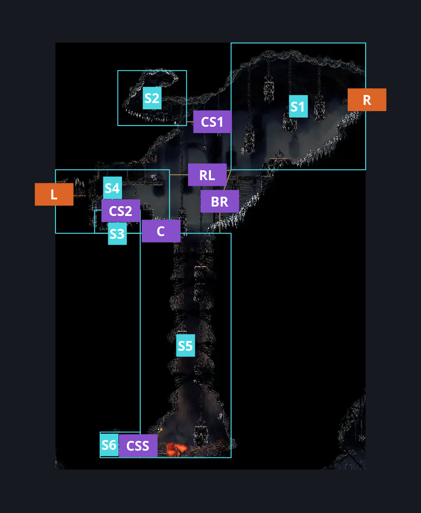
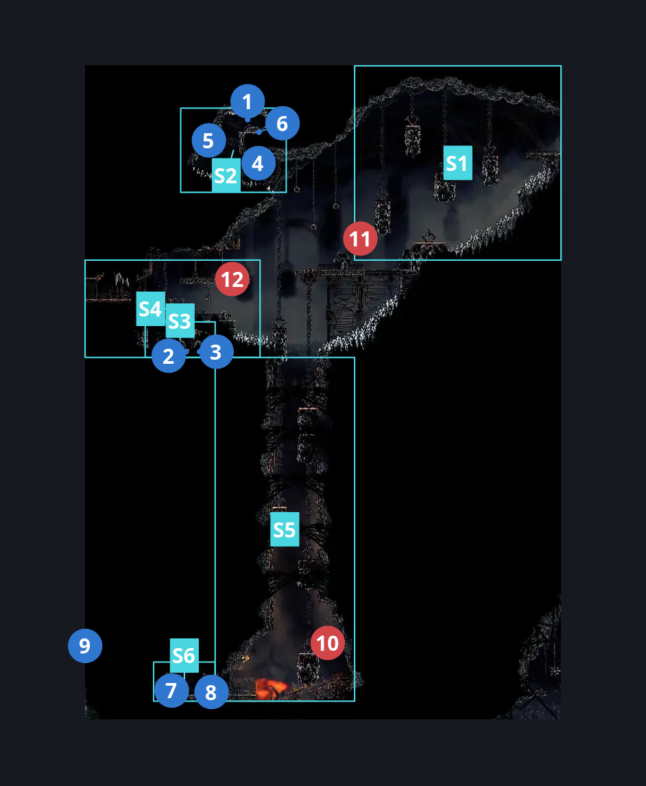
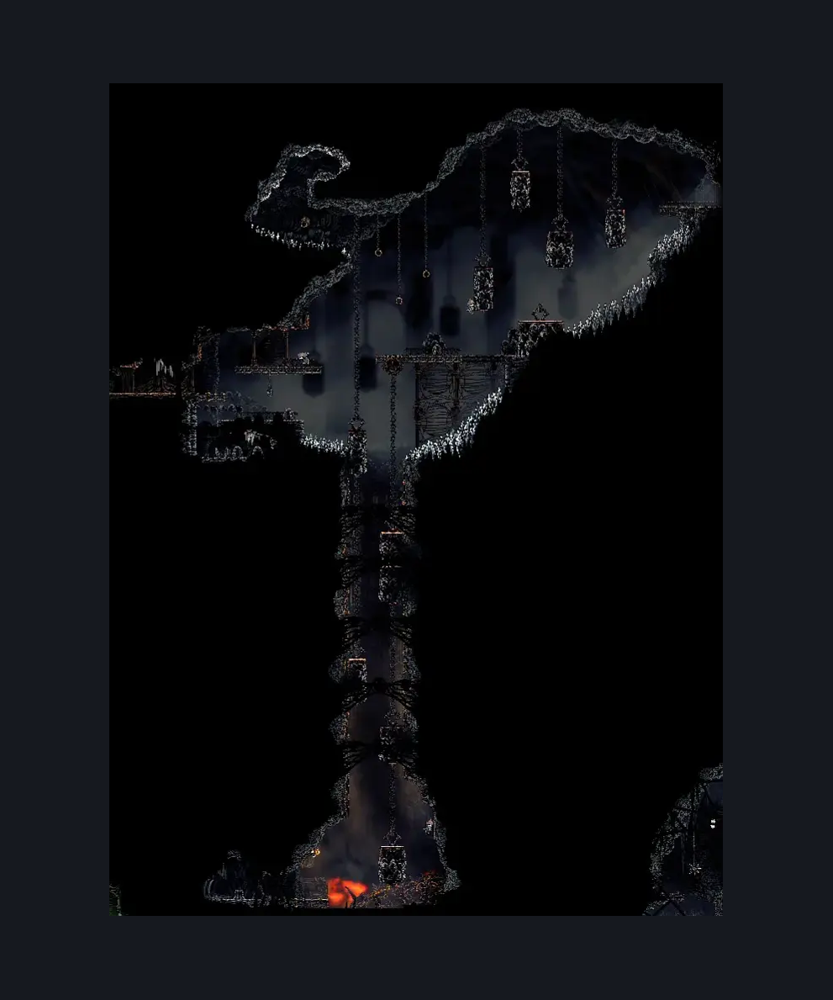

# Underworks Silk Spool (Library_11b)

**Game ID:** Library_11b

**Contributors:** Rebel

## Subrooms

| No. | Subroom | Annotated |
| --- | --- | --- |
| S1 | Upper Right | ✓ |
| S2 | Shell Shard Alcove #1 | ✓ |
| S3 | Shell Shard Alcove #2 | ✓ |
| S4 | Upper Left | ✓ |
| S5 | Bottom | ✓ |
| S6 | Silk Spool | ✓ |

## Room Transitions

| Alias | Name | From subroom | Destination | Destination alias | Requirements | TODO | Verification | Annotated | Notes |
| --- | --- | --- | --- | --- | --- | --- | --- | --- | --- |
| L | left3 | Upper Left | [Underworks Twelfth Architect (Under_17)](underworks-twelfth-architect.md) | FR | Nothing. |  | Verified | ✓ |  |
| R | right1 | Upper Right | [Vaults & Bellway Cauldron Entrance (Library_11)](vaults-bellway-cauldron-entrance.md) | LL | Nothing. |  | Verified | ✓ |  |

## Subroom Connections

| Alias | Name | Source | Destination | Requirements | TODO | Verification | Annotated | Notes |
| --- | --- | --- | --- | --- | --- | --- | --- | --- |
| RL | Right-Left | Upper Left | Upper Right | (Spike Pogo AND Ledge Grab) OR ((Sprint OR Dash OR Clawline OR Sharp Dart) AND ((Silk Soar OR Cling Grip OR Scuttlebrace OR (Faydown Cloak AND (Ledge Grab OR Clawline))))) |  | Verified | ✓ |  |
| CS1 | Collect Shards #1 | Upper Right | Shell Shard Alcove #1 | (Faydown Cloak AND Drifter's Cloak AND Ledge Grab AND Spike Pogo) OR ((Cling Grip OR Scuttlebrace) AND (Clawline OR (Dash AND Sharp Dart AND Spike Pogo AND Ledge Grab))) |  | Verified | ✓ |  |
| CS2 | Collect Shards #2 | Upper Left | Shell Shard Alcove #2 | Nothing. (Fall) |  | Verified | ✓ |  |
| CSS | Collect Silk Spool | Bottom | Silk Spool | Activate Underworks Silk Spool Wall |  | Verified | ✓ |  |
| C | Climb | Upper Left | Bottom | Nothing. (Fall) |  | Verified | ✓ |  |
| C | Climb | Bottom | Upper Left | Cling Grip OR (Scuttlebrace AND Faydown Cloak) |  | Verified | ✓ |  |
| CS2 | Collect Shards #2 | Shell Shard Alcove #2 | Upper Left | Ledge Grab OR Clawline OR Cling Grip OR Scuttlebrace OR Faydown Cloak OR Silk Soar |  | Verified | ✓ |  |
| CSS | Collect Silk Spool | Silk Spool | Bottom | Nothing. |  | Verified | ✓ |  |
| CS1 | Collect Shards #1 | Shell Shard Alcove #1 | Upper Right | Spike Pogo OR Dash OR Clawline OR Sharp Dart OR Drifter's cloak OR Faydown Cloak OR Scuttlebrace |  | Verified | ✓ |  |
| RL | Right-Left | Upper Right | Upper Left | Sprint OR Dash OR Faydown Cloak OR Drifter's Cloak OR Silk Soar OR Clawline OR Sharpdart OR Scuttlebrace OR Easy Hunter Pogo OR ((Easy Reaper Pogo OR Easy Witch Pogo) AND (Ledge Grab OR Cling Grip)) OR Easy Beast Pogo OR Easy Architect Pogo OR Easy Shaman Pogo OR Easy Reaper Charge OR Easy Beast Charge OR Easy Wanderer Charge OR Easy Witch Charge OR Easy Architect Charge OR Flea Brew OR Easy Flea Brew Stall OR Easy Voltvessels Stall OR Easy Plasmium Stall OR Easy Flintslate Stall |  | Verified | ✓ |  |
| BR | Bottom-Right | Upper Right | Bottom | Nothing (Fall) |  | Verified | ✓ |  |
| BR | Bottom-Right | Bottom | Upper Right | ( ( ( ( (Faydown Cloak AND Ledge Grab Left) OR Magma Bell) AND (Silk Soar AND Proficient Movement) ) OR (Cling Grip Right AND Faydown Cloak) OR Cling Grip Left OR ( (Scuttlebrace AND ( Faydown Cloak OR ( Easy [Shaman] Pogo AND Ponder the Orb AND Sprint) ) ) ) ) AND ( ( Sharpdart x 2 AND Faydown Cloak AND Cling Grip Right ) OR ( Clawline Right AND ( Faydown Cloak OR Medium Pogo OFF [Underloft] OR Cling Grip Right) ) OR ( Spike Pogo AND (Medium Pogo OFF [Underloft] OR Faydown Cloak OR Cling Grip Right OR Ledge Grab Right ) ) ) ) |  | Verified | ✓ | wack. |

## Check Locations

| No. | Check | Subroom | Requirements | TODO | Verification | Location Type | Annotated | Notes |
| --- | --- | --- | --- | --- | --- | --- | --- | --- |
| 1 | Underworks: Shell Shard Rock #3 | Shell Shard Alcove #1 | Nothing. |  | Verified | collectible | ✓ |  |
| 2 | Underworks: Shell Shard Rock #4 | Shell Shard Alcove #2 | Nothing. |  | Verified | collectible | ✓ |  |
| 3 | Underworks: Shell Shard Rock #5 | Shell Shard Alcove #2 | Nothing. |  | Verified | collectible | ✓ |  |
| 4 | Underworks: Shell Shard Rock #6 | Shell Shard Alcove #1 | Nothing. |  | Verified | collectible | ✓ |  |
| 5 | Underworks: Shell Shard Cache #2 | Shell Shard Alcove #1 | Nothing. |  | Verified | collectible | ✓ |  |
| 6 | Underworks: Shell Shard Cache #3 | Shell Shard Alcove #1 | Nothing. |  | Verified | collectible | ✓ |  |
| 7 | Underworks: Silk Spool Fragment #1 | Silk Spool | Nothing. |  | Verified | collectible | ✓ |  |
| 8 | Underworks Silk Spool Wall | Bottom | Break Wall Left |  | Verified | blockade | ✓ | Fixed subroom assignment - Morch |
| 9 | Memory Orb Challenge (1) |  |  | TODO |  |  | ✓ | what the hell is this? |
| 10 | Underloft 1 | Bottom | nada |  | Verified | enemy | ✓ |  |
| 11 | Underloft 2 | Upper Right | free |  | Verified | enemy | ✓ |  |
| 12 | Underpoke 1 | Upper Left | nothing |  | Verified | enemy | ✓ |  |

## Room Images

### Connections

### Checks

### Scene

