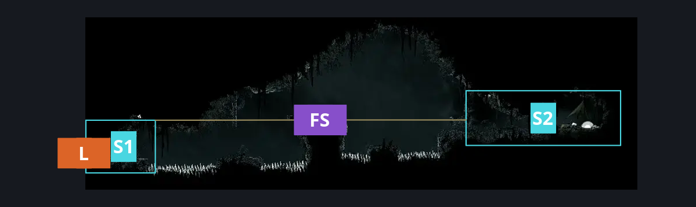
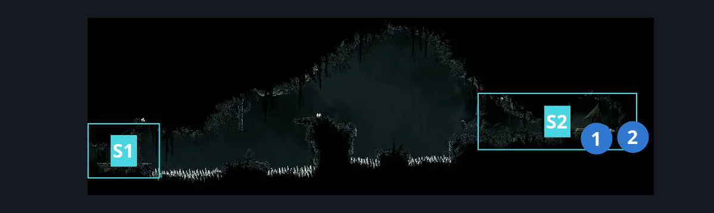
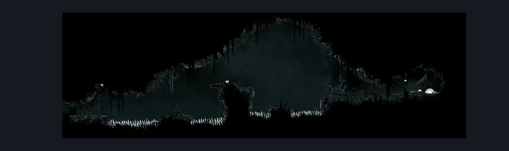

# Dead Verdania Bench (Clover_20)

**Game ID:** Clover_20

**Contributors:** Pyxl Mapping Machine

## Subrooms

| No. | Subroom | Annotated |
| --- | --- | --- |
| S1 | Entrance | ✓ |
| S2 | Bench | ✓ |

## Room Transitions

| Alias | Name | From subroom | Destination | Destination alias | Requirements | TODO | Verification | Annotated | Notes |
| --- | --- | --- | --- | --- | --- | --- | --- | --- | --- |
| L | left1 | Entrance | [Dead Verdania Main (Clover_01)](dead-verdania-main.md) | R | None |  | Verified | ✓ |  |

## Subroom Connections

| Alias | Name | Source | Destination | Requirements | TODO | Verification | Annotated | Notes |
| --- | --- | --- | --- | --- | --- | --- | --- | --- |
| FS | Fookin Spiders | Entrance | Bench | ( ( ( Silk Soar AND ( Easy Beast Crest Pogo OR Dash right OR Clawline right OR Faydown Cloak OR Drifters Cloak ) ) OR ( Faydown Cloak AND ( Cling Grip right OR Ledge Grab right ) ) ) AND ( Clawline right OR ( Dash right AND ( Faydown Cloak OR Drifters Cloak ) ) OR Sharpdart ) ) |  | Verified | ✓ |  |
| FS | Fookin Spiders | Bench | Entrance | ( ( ( Silk Soar AND ( Easy Beast Crest Pogo OR Dash left OR Clawline left OR Faydown Cloak OR Drifters Cloak ) ) OR ( Faydown Cloak AND ( Cling Grip left OR Ledge Grab left ) ) ) AND ( Clawline left OR ( Dash left AND ( Faydown Cloak OR Drifters Cloak ) ) OR Sharpdart ) ) |  | Verified | ✓ |  |

## Check Locations

| No. | Check | Subroom | Requirements | TODO | Verification | Location Type | Annotated | Notes |
| --- | --- | --- | --- | --- | --- | --- | --- | --- |
| 1 | Dead Verdania Bench | Bench | None |  | Verified | bench | ✓ |  |
| 2 | Map Verdania | Bench | None |  | Verified | collectible | ✓ |  |

## Room Images

### Connections

### Checks

### Scene

