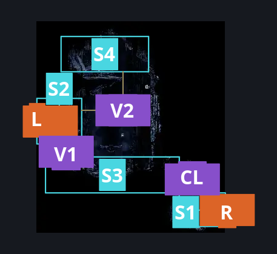
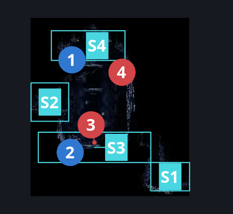
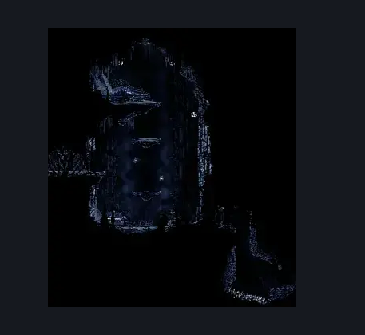

# Weavenest Atla Lore (Weave_08)

**Game ID:** Weave_08

**Contributors:** herounit

## Subrooms

| No. | Subroom | Annotated |
| --- | --- | --- |
| S1 | right exit area | ✓ |
| S2 | left exit area | ✓ |
| S3 | ground floor | ✓ |
| S4 | upper platform | ✓ |

## Room Transitions

| Alias | Name | From subroom | Destination | Destination alias | Requirements | TODO | Verification | Annotated | Notes |
| --- | --- | --- | --- | --- | --- | --- | --- | --- | --- |
| L | left | left exit area | [Weavenest Atla Hallway (Weave_13)](weavenest-atla-hallway.md) | R | none |  | Verified | ✓ |  |
| R | right | right exit area | [Weavenest Atla Mask Shard (Weave_05b)](weavenest-atla-mask-shard.md) | L | none |  | Verified | ✓ |  |

## Subroom Connections

| Alias | Name | Source | Destination | Requirements | TODO | Verification | Annotated | Notes |
| --- | --- | --- | --- | --- | --- | --- | --- | --- |
| CL | climb pit | ground floor | right exit area | break wall right  AND (  spike pogo  OR dash right OR drifters  OR faydown OR cling grip either OR clawline right OR sharpdart  OR easy scuttlebrace ) |  | Verified | ✓ |  |
| CL | climb pit | right exit area | ground floor | break wall left  AND ( easy scuttlebrace OR ( cling grip left AND ( spike pogo OR run OR dash left OR drifter's cloak OR faydown cloak OR clawline left OR sharpdart OR flea brew OR (cling grip right AND proficient movement) ) ) OR (cling grip right AND (faydown OR easy shaman pogo))) |  | Verified | ✓ |  |
| V1 | vertical 1 | ground floor | left exit area | ledge grab either OR cling grip either OR faydown cloak OR silk soar OR easy [hunter,wanderer,reaper,beast,architect,witch,shaman] pogo (background object) |  | Verified | ✓ |  |
| V1 | vertical 1 | left exit area | ground floor | none (falling) |  | Verified | ✓ |  |
| V2 | vertical 2 | left exit area | upper platform | ledge grab both OR cling grip right OR ( ledge grab right AND easy pogo off servitor ignim AND ( medium [shaman, wanderer, reaper, architect] pogo (single chance, bench respawn) ) ) OR ( proficient movement AND cling grip left (frame perfect?) ) OR faydown cloak  OR silk soar |  | Verified | ✓ |  |
| V2 | vertical 2 | upper platform | left exit area | none (falling) |  | Verified | ✓ |  |

## Check Locations

| No. | Check | Subroom | Requirements | TODO | Verification | Location Type | Annotated | Notes |
| --- | --- | --- | --- | --- | --- | --- | --- | --- |
| 1 | rune harp weavenest atla | upper platform | none |  | Verified | collectible | ✓ |  |
| 2 | weavenest atla archive inscription | ground floor | none |  | Verified | lore | ✓ |  |
| 3 | Servitor Ignim 1 | ground floor | none |  | Verified | enemy | ✓ |  |
| 4 | Servitor Ignim 2 | upper platform | none |  | Verified | enemy | ✓ |  |

## Room Images

### Connections

### Checks

### Scene

