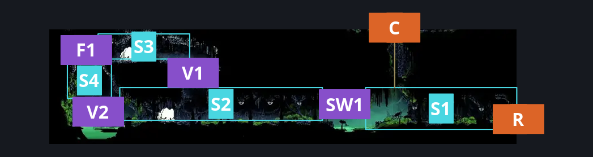
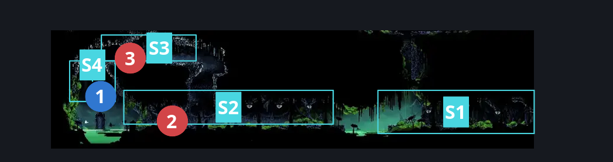
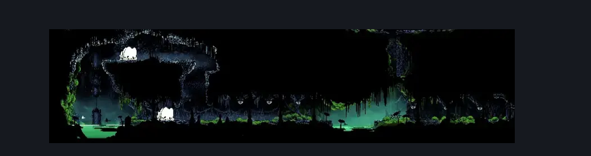

# Weavenest Atla Spool (Weave_11)

**Game ID:** Weave_11

**Contributors:** herounit, Pyxl

## Subrooms

| No. | Subroom | Annotated |
| --- | --- | --- |
| S1 | right exit area | ✓ |
| S2 | mid passage | ✓ |
| S3 | upper left passage | ✓ |
| S4 | spool spot | ✓ |

## Room Transitions

| Alias | Name | From subroom | Destination | Destination alias | Requirements | TODO | Verification | Annotated | Notes |
| --- | --- | --- | --- | --- | --- | --- | --- | --- | --- |
| R | right | right exit area | [Weavenest Atla Teleporter (Weave_02)](weavenest-atla-teleporter.md) | ML | none |  | Verified | ✓ |  |
| C | ceiling | right exit area | [Weavenest Atla Snare (Weave_14)](weavenest-atla-snare.md) | F | silk soar  OR ( faydown cloak AND ( cling grip right OR easy scuttlebrace OR ( cling grip left AND easy beast crest heal stall AND easy flea brew stall x 1 ) ) ) |  | Verified | ✓ |  |

## Subroom Connections

| Alias | Name | Source | Destination | Requirements | TODO | Verification | Annotated | Notes |
| --- | --- | --- | --- | --- | --- | --- | --- | --- |
| SW1 | swim 1 | right exit area | mid passage | swim  OR clawline left OR sharpdart  OR faydown OR drifters OR medium beast pogo OR easy beast charge OR medium plasmium stall x 4 OR ( ( dash left AND (cling grip left  OR ledge grab left  OR run left OR flea brew  OR easy plasmium stall OR easy voltvessels stall OR easy heal stall  OR easy [hunter,beast,shaman,architect] pogo OR easy architect charge) ) )  OR ( run left AND ( easy beast pogo )) OR ( easy [hunter,architect] pogo AND ( medium voltvessels stall OR medium silkshot original stall OR medium plasmium stall)) OR ( easy [hunter,wanderer] voltwater pogo ) |  | Verified | ✓ |  |
| SW1 | swim 1 | mid passage | right exit area | swim OR clawline right OR sharpdart OR ( run right AND ( proficient movement OR easy beast charge OR ( dash right AND ( ledge grab right OR cling grip right OR easy architect charge )))) OR ( easy beast pogo AND ( dash right OR cling grip left OR ( cling grip right AND medium [voltvessels,plasmium] stall ))) OR ( faydown AND ( drifters OR dash right OR cling grip left OR medium hunter pogo OR easy [shaman,beast,architect] pogo OR easy flintslate stall x 2 OR easy [voltvessels,plasmium] stall OR flea brew OR easy [architect,wanderer] charge OR medium witch charge OR ( easy reaper charge AND ( ledge grab right OR cling grip right )))) OR ( dash right AND easy beast charge ) OR ( cling grip left AND ( easy [architect,beast] charge OR dash right OR ( flea brew AND ( cling grip right OR ledge grab right  )))) OR ( easy beast charge AND ( ledge grab right OR cling grip right ) AND easy [voltvessels,plasmium] stall ) OR ( easy hunter pogo AND medium voltvessels stall AND ( cling grip right OR ledge grab right )) |  | Verified | ✓ |  |
| V1 | vertical 1 | mid passage | upper left passage | ledge grab both OR cling grip either OR ( easy pogo off marrowmaw AND ledge grab right ) OR faydown OR easy scuttlebrace OR ( ledge grab right AND easy beast bind stall AND easy plasmium stall ) OR ( ledge grab left AND medium beast bind stall AND medium plasmium stall ) |  | Verified | ✓ |  |
| V1 | vertical 1 | upper left passage | mid passage | none (falling) |  | Verified | ✓ |  |
| F1 | fall 1 | upper left passage | spool spot | none (falling) |  | Verified | ✓ |  |
| V2 | vertical 2 | mid passage | spool spot | faydown cloak OR easy [hunter,wanderer] voltwater pogo |  | Verified | ✓ |  |
| V2 | vertical 2 | spool spot | mid passage | none (falling) |  | Verified | ✓ |  |

## Check Locations

| No. | Check | Subroom | Requirements | TODO | Verification | Location Type | Annotated | Notes |
| --- | --- | --- | --- | --- | --- | --- | --- | --- |
| 1 | weavenest atla spool fragment | spool spot | none |  | Verified | collectible | ✓ |  |
| 2 | Marrowmaw 1 | mid passage | None |  | Verified | enemy | ✓ |  |
| 3 | Marrowmaw 2 | upper left passage | None |  | Verified | enemy | ✓ |  |

## Room Images

### Connections

### Checks

### Scene

