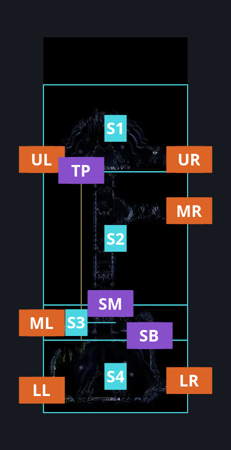
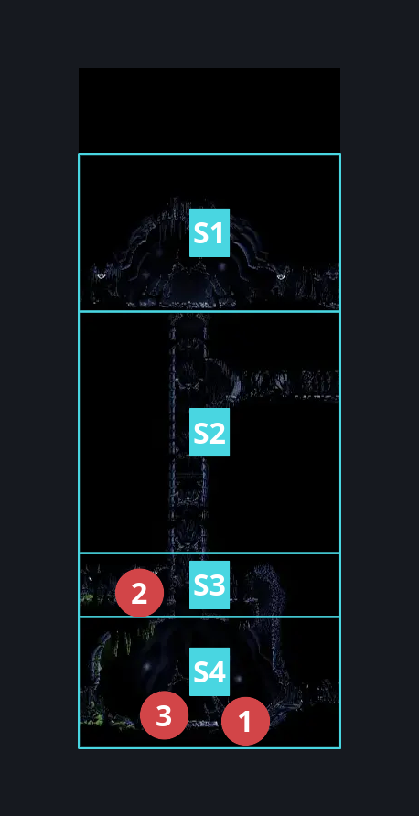
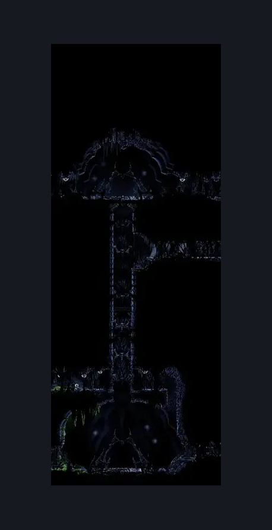

# Weavenest Atla Teleporter (Weave_02)

**Game ID:** Weave_02

**Contributors:** herounit

## Subrooms

| No. | Subroom | Annotated |
| --- | --- | --- |
| S1 | upper telepad | ✓ |
| S2 | upper shaft | ✓ |
| S3 | lower shaft | ✓ |
| S4 | lower telepad | ✓ |

## Room Transitions

| Alias | Name | From subroom | Destination | Destination alias | Requirements | TODO | Verification | Annotated | Notes |
| --- | --- | --- | --- | --- | --- | --- | --- | --- | --- |
| UL | upper left | upper telepad | [Weavenest Atla Entrance (Weave_04)](weavenest-atla-entrance.md) | R | none |  | Verified | ✓ |  |
| UR | upper right | upper telepad | [Weavenest Atla Power Room (Weave_12)](weavenest-atla-power-room.md) | L | none |  | Verified | ✓ |  |
| MR | middle right | upper shaft | [Weavenest Atla Hallway (Weave_13)](weavenest-atla-hallway.md) | L | none |  | Verified | ✓ |  |
| ML | middle left | lower shaft | [Weavenest Atla Spool (Weave_11)](weavenest-atla-spool.md) | R | none |  | Verified | ✓ |  |
| LL | lower left | lower telepad | [Weavenest Atla Bench (Weave_07)](weavenest-atla-bench.md) | R | none |  | Verified | ✓ |  |
| LR | lower right | lower telepad | [Weavenest Atla Eva (Weave_10)](weavenest-atla-eva.md) | L | break wall right |  | Verified | ✓ |  |

## Subroom Connections

| Alias | Name | Source | Destination | Requirements | TODO | Verification | Annotated | Notes |
| --- | --- | --- | --- | --- | --- | --- | --- | --- |
| TP | teleporter | upper telepad | lower telepad | complete THE weavenest atla power activation |  | Verified | ✓ |  |
| TP | teleporter | lower telepad | upper telepad | complete THE weavenest atla power activation |  | Verified | ✓ |  |
| SM | shaft middle | lower shaft | upper shaft | cling grip either OR silk soar OR ( easy scuttlebrace AND (medium beast bind stall OR medium shaman pogo OR (easy [shaman,reaper,beast,architect] pogo AND medium pogo off servitor ignim)) ) |  | Verified | ✓ |  |
| SM | shaft middle | upper shaft | lower shaft | none (falling) |  | Verified | ✓ |  |
| SB | shaft base | lower telepad | lower shaft | cling grip right  OR silk soar  OR ( faydown AND easy scuttlebrace ) OR ( cling grip left AND faydown AND ( clawline right OR sharpdart ) ) OR ( medium shaman pogo AND medium scuttlebrace ) |  | Verified | ✓ |  |
| SB | shaft base | lower shaft | lower telepad | none (falling) |  | Verified | ✓ |  |

## Check Locations

| No. | Check | Subroom | Requirements | TODO | Verification | Location Type | Annotated | Notes |
| --- | --- | --- | --- | --- | --- | --- | --- | --- |
| 1 | Servitor Ignim 1 | lower telepad | None |  | Verified | enemy | ✓ |  |
| 2 | Servitor Ignim 2 | lower shaft | None |  | Verified | enemy | ✓ |  |
| 3 | Servitor Ignim 3 | lower telepad | None |  | Verified | enemy | ✓ | Spawn conditions: wokeLiftWeaver=false |

## Room Images

### Connections

### Checks

### Scene

