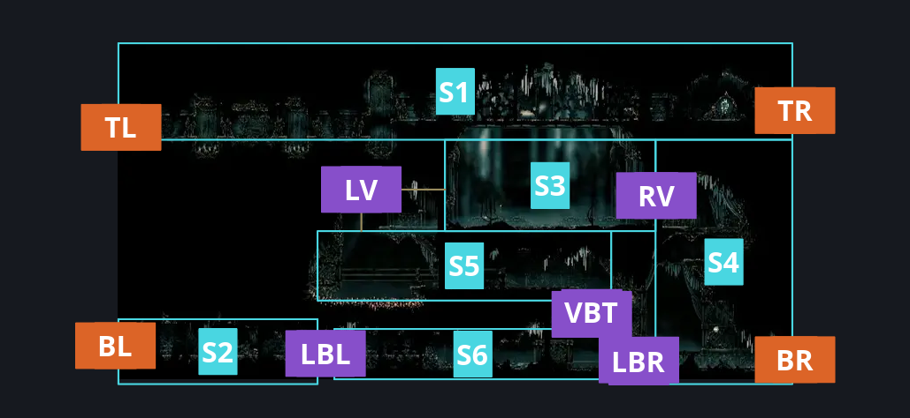
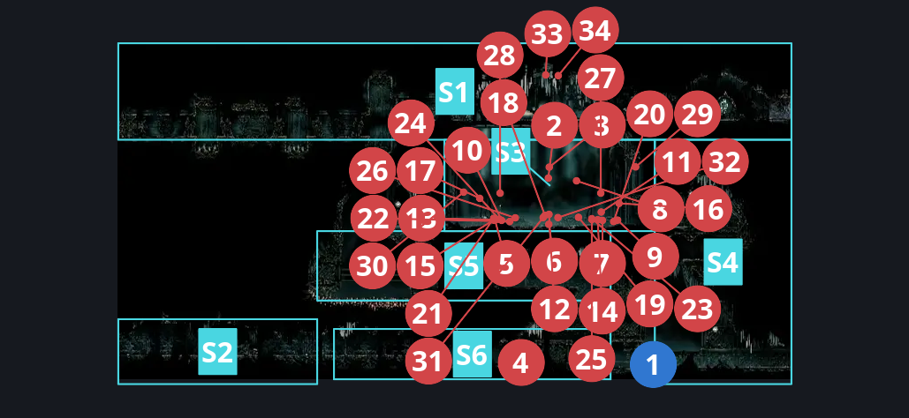
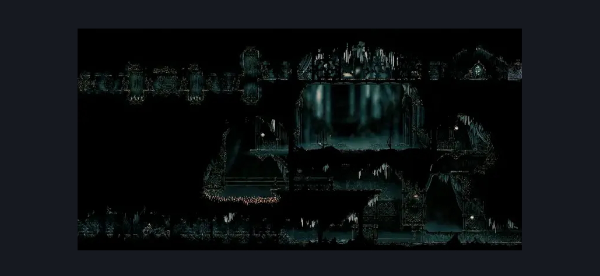

# Songclave Steam Tunnel (Library_02)

**Game ID:** Library_02

**Contributors:** Rebel, Gallos

## Subrooms

| No. | Subroom | Annotated |
| --- | --- | --- |
| S1 | Top | ✓ |
| S2 | Bottom Left | ✓ |
| S3 | Arena | ✓ |
| S4 | Bottom Right | ✓ |
| S5 | Upper Blocks | ✓ |
| S6 | Lower Blocks | ✓ |

## Room Transitions

| Alias | Name | From subroom | Destination | Destination alias | Requirements | TODO | Verification | Annotated | Notes |
| --- | --- | --- | --- | --- | --- | --- | --- | --- | --- |
| TL | left2 | Top | [Rotating Tunnel (Song_20b)](../choral-chambers/rotating-tunnel.md) | R1 | Nothing. |  | Verified | ✓ |  |
| TR | right2 | Top | [Songclave (Song_Enclave)](../choral-chambers/songclave.md) | BL | Nothing. |  | Verified | ✓ |  |
| BL | left1 | Bottom Left | [Rotating Tunnel (Song_20b)](../choral-chambers/rotating-tunnel.md) | RH | Nothing. |  | Verified | ✓ |  |
| BR | right1 | Bottom Right | [Whispering Vaults Flea Shaft (Library_01)](whispering-vaults-flea-shaft.md) | TL | Nothing. |  | Verified | ✓ |  |

## Subroom Connections

| Alias | Name | Source | Destination | Requirements | TODO | Verification | Annotated | Notes |
| --- | --- | --- | --- | --- | --- | --- | --- | --- |
| LBR | Lower Block Right Travel | Lower Blocks | Bottom Right | Activate Logic Box |  | Verified | ✓ |  |
| LBR | Lower Block Right Travel | Bottom Right | Lower Blocks | Activate Logic Box |  | Verified | ✓ |  |
| VBT | Lower <> Upper Block | Lower Blocks | Upper Blocks | Silk Soar  OR cling grip right OR ((easy Scuttlebrace AND (Faydown Cloak OR Clawline left OR Sharpdart OR ((Drifter's Cloak OR Dash left) AND (Ledge Grab left OR cling grip left)))))  OR easy shaman scuttle slide OR ((Activate Logic Box OR elite ball knowledge (Box Pogo)) AND Faydown Cloak AND (ledge grab left OR cling grip left)) OR (Activate Logic Box AND proficient movement AND Faydown Cloak) |  | Verified | ✓ |  |
| VBT | Lower <> Upper Block | Upper Blocks | Lower Blocks | Nothing. (Fall) |  | Verified | ✓ |  |
| LV | Left Vertical | Upper Blocks | Arena | (Faydown Cloak AND Ledge Grab right)  OR (Cling Grip left AND (Spike Pogo OR Dash left OR Sharpdart OR Clawline left OR Drifter's Cloak OR Sprint OR faydown))  OR (easy Scuttlebrace AND spike pogo AND (Faydown Cloak OR (Dash right AND Ledge Grab right) OR Clawline right OR Sharpdart OR Easy [shaman,Beast] Pogo OR easy [flea brew, parry, flintslate, plasmium,air heal,thread storm,rune rage,pale nails] stall)) |  | Verified | ✓ |  |
| LV | Left Vertical | Arena | Upper Blocks | Spike Pogo  OR Proficient Movement (Easy Box Pogo)  OR Clawline right  OR Faydown Cloak  OR dash right OR Drifter's Cloak OR Sharpdart OR (easy naked pogo AND easy hazard respawn) |  | Verified | ✓ |  |
| RV | Right Vertical | Arena | Bottom Right | defeat Whispering Vaults: Arena #1 |  | Verified | ✓ |  |
| RV | Right Vertical | Bottom Right | Arena | defeat Whispering Vaults: Arena #1 AND (Silk Soar x 2 OR Cling Grip left OR (easy Scuttlebrace AND Faydown Cloak)) |  | Verified | ✓ |  |
| LBL | Lower Block Left Travel | Bottom Left | Lower Blocks | Nothing |  | Verified | ✓ |  |
| LBL | Lower Block Left Travel | Lower Blocks | Bottom Left | Nothing |  | Verified | ✓ |  |

## Check Locations

| No. | Check | Subroom | Requirements | TODO | Verification | Location Type | Annotated | Notes |
| --- | --- | --- | --- | --- | --- | --- | --- | --- |
| 1 | Logic Box | Bottom Right | Attack Right OR Attack Left |  | Verified | logic-point | ✓ | < add predicate |
| 2 | Whispering Vaults: Arena #1 | Arena | Combat Requirements |  | Verified | gauntlet | ✓ |  |
| 3 | Whispering Vaults: Arena #2 | Arena | defeat Whispering Vaults: Arena #1 AND activate Whispering Vaults: Release the mosquitoes IN whispering vaults vaultborn lever AND Combat requirements |  | Verified | gauntlet | ✓ |  |
| 4 | Drapemite 1 | Lower Blocks | none |  | Verified | enemy | ✓ |  |
| 5 | Choristor 1 | Arena | none |  | Verified | enemy | ✓ | FSM Boolean flags: completedLibraryEntryBattle, scholarAcolytesInLibrary_02, completedLibraryAcolyteBattle |
| 6 | Choir Flyer 1 | Arena | none |  | Verified | enemy | ✓ | FSM Boolean flags: completedLibraryEntryBattle, scholarAcolytesInLibrary_02, completedLibraryAcolyteBattle |
| 7 | Choir Hornhead 1 | Arena | none |  | Verified | enemy | ✓ | FSM Boolean flags: completedLibraryEntryBattle, scholarAcolytesInLibrary_02, completedLibraryAcolyteBattle |
| 8 | Choir Elder 1 | Arena | none |  | Verified | enemy | ✓ | FSM Boolean flags: completedLibraryEntryBattle, scholarAcolytesInLibrary_02, completedLibraryAcolyteBattle |
| 9 | Choir Pouncer 1 | Arena | none |  | Verified | enemy | ✓ | FSM Boolean flags: completedLibraryEntryBattle, scholarAcolytesInLibrary_02, completedLibraryAcolyteBattle |
| 10 | Choir Hornhead 2 | Arena | none |  | Verified | enemy | ✓ | FSM Boolean flags: completedLibraryEntryBattle, scholarAcolytesInLibrary_02, completedLibraryAcolyteBattle |
| 11 | Reed 1 | Arena | none |  | Verified | enemy | ✓ | FSM Boolean flags: completedLibraryEntryBattle, scholarAcolytesInLibrary_02, completedLibraryAcolyteBattle |
| 12 | Choir Bellbearer 1 | Arena | none |  | Verified | enemy | ✓ | FSM Boolean flags: completedLibraryEntryBattle, scholarAcolytesInLibrary_02, completedLibraryAcolyteBattle |
| 13 | Choir Flyer 2 | Arena | none |  | Verified | enemy | ✓ | FSM Boolean flags: completedLibraryEntryBattle, scholarAcolytesInLibrary_02, completedLibraryAcolyteBattle |
| 14 | Choristor 2 | Arena | none |  | Verified | enemy | ✓ | FSM Boolean flags: completedLibraryEntryBattle, scholarAcolytesInLibrary_02, completedLibraryAcolyteBattle |
| 15 | Choir Pouncer 2 | Arena | none |  | Verified | enemy | ✓ | FSM Boolean flags: completedLibraryEntryBattle, scholarAcolytesInLibrary_02, completedLibraryAcolyteBattle |
| 16 | Choir Flyer 3 | Arena | none |  | Verified | enemy | ✓ | FSM Boolean flags: completedLibraryEntryBattle, scholarAcolytesInLibrary_02, completedLibraryAcolyteBattle |
| 17 | Choir Bellbearer 2 | Arena | none |  | Verified | enemy | ✓ | FSM Boolean flags: completedLibraryEntryBattle, scholarAcolytesInLibrary_02, completedLibraryAcolyteBattle |
| 18 | Vaultkeeper 1 | Arena | none |  | Verified | enemy | ✓ | FSM Boolean flags: encounteredLibraryEntryBattle, completedLibraryEntryBattle, scholarAcolytesInLibrary_02, completedLibraryAcolyteBattle |
| 19 | Vaultborn 1 | Arena | defeat Whispering Vaults: Arena #1 AND activate Whispering Vaults: Release the mosquitoes IN whispering vaults vaultborn lever |  | Verified | enemy | ✓ | FSM Boolean flags: completedLibraryEntryBattle, scholarAcolytesInLibrary_02, completedLibraryAcolyteBattle |
| 20 | Vaultborn 2 | Arena | defeat Whispering Vaults: Arena #1 AND activate Whispering Vaults: Release the mosquitoes IN whispering vaults vaultborn lever |  | Verified | enemy | ✓ | FSM Boolean flags: completedLibraryEntryBattle, scholarAcolytesInLibrary_02, completedLibraryAcolyteBattle |
| 21 | Vaultborn 3 | Arena | defeat Whispering Vaults: Arena #1 AND activate Whispering Vaults: Release the mosquitoes IN whispering vaults vaultborn lever |  | Verified | enemy | ✓ | FSM Boolean flags: completedLibraryEntryBattle, scholarAcolytesInLibrary_02, completedLibraryAcolyteBattle |
| 22 | Vaultborn 4 | Arena | defeat Whispering Vaults: Arena #1 AND activate Whispering Vaults: Release the mosquitoes IN whispering vaults vaultborn lever |  | Verified | enemy | ✓ | FSM Boolean flags: completedLibraryEntryBattle, scholarAcolytesInLibrary_02, completedLibraryAcolyteBattle |
| 23 | Vaultborn 5 | Arena | defeat Whispering Vaults: Arena #1 AND activate Whispering Vaults: Release the mosquitoes IN whispering vaults vaultborn lever |  | Verified | enemy | ✓ | FSM Boolean flags: completedLibraryEntryBattle, scholarAcolytesInLibrary_02, completedLibraryAcolyteBattle |
| 24 | Vaultborn 6 | Arena | defeat Whispering Vaults: Arena #1 AND activate Whispering Vaults: Release the mosquitoes IN whispering vaults vaultborn lever |  | Verified | enemy | ✓ | FSM Boolean flags: completedLibraryEntryBattle, scholarAcolytesInLibrary_02, completedLibraryAcolyteBattle |
| 25 | Vaultborn 7 | Arena | defeat Whispering Vaults: Arena #1 AND activate Whispering Vaults: Release the mosquitoes IN whispering vaults vaultborn lever |  | Verified | enemy | ✓ | FSM Boolean flags: completedLibraryEntryBattle, scholarAcolytesInLibrary_02, completedLibraryAcolyteBattle |
| 26 | Vaultborn 8 | Arena | defeat Whispering Vaults: Arena #1 AND activate Whispering Vaults: Release the mosquitoes IN whispering vaults vaultborn lever |  | Verified | enemy | ✓ | FSM Boolean flags: completedLibraryEntryBattle, scholarAcolytesInLibrary_02, completedLibraryAcolyteBattle |
| 27 | Vaultkeeper 2 | Arena | defeat Whispering Vaults: Arena #1 AND activate Whispering Vaults: Release the mosquitoes IN whispering vaults vaultborn lever |  | Verified | enemy | ✓ | FSM Boolean flags: encounteredLibraryEntryBattle, completedLibraryEntryBattle, scholarAcolytesInLibrary_02, completedLibraryAcolyteBattle |
| 28 | Vaultkeeper 3 | Arena | defeat Whispering Vaults: Arena #1 AND activate Whispering Vaults: Release the mosquitoes IN whispering vaults vaultborn lever |  | Verified | enemy | ✓ | FSM Boolean flags: encounteredLibraryEntryBattle, completedLibraryEntryBattle, scholarAcolytesInLibrary_02, completedLibraryAcolyteBattle |
| 29 | Vaultborn 9 | Arena | defeat Whispering Vaults: Arena #1 AND activate Whispering Vaults: Release the mosquitoes IN whispering vaults vaultborn lever |  | Verified | enemy | ✓ | FSM Boolean flags: scholarAcolytesReleased, completedLibraryEntryBattle, scholarAcolytesInLibrary_02, completedLibraryAcolyteBattle |
| 30 | Vaultborn 10 | Arena | defeat Whispering Vaults: Arena #1 AND activate Whispering Vaults: Release the mosquitoes IN whispering vaults vaultborn lever |  | Verified | enemy | ✓ | FSM Boolean flags: scholarAcolytesReleased, completedLibraryEntryBattle, scholarAcolytesInLibrary_02, completedLibraryAcolyteBattle |
| 31 | Vaultborn 11 | Arena | defeat Whispering Vaults: Arena #1 AND activate Whispering Vaults: Release the mosquitoes IN whispering vaults vaultborn lever |  | Verified | enemy | ✓ | FSM Boolean flags: scholarAcolytesReleased, completedLibraryEntryBattle, scholarAcolytesInLibrary_02, completedLibraryAcolyteBattle |
| 32 | Vaultborn 12 | Arena | defeat Whispering Vaults: Arena #1 AND activate Whispering Vaults: Release the mosquitoes IN whispering vaults vaultborn lever |  | Verified | enemy | ✓ | FSM Boolean flags: scholarAcolytesReleased, completedLibraryEntryBattle, scholarAcolytesInLibrary_02, completedLibraryAcolyteBattle |
| 33 | Drapefly 1 | Top | Invalid |  | Verified | enemy | ✓ | Disabled; no activation found. |
| 34 | Drapefly 2 | Top | Normal World Spawn |  | Verified | enemy | ✓ |  |

## Notes

No connection from Top to the rest of the subrooms.

## Room Images

### Connections

### Checks

### Scene

