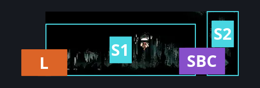
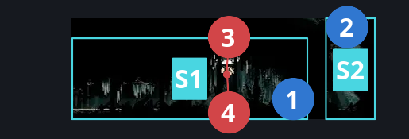
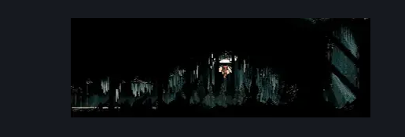

# Whispering Vaults Silkeater (Library_14)

**Game ID:** Library_14

**Contributors:** Rebel, Gallos

## Subrooms

| No. | Subroom | Annotated |
| --- | --- | --- |
| S1 | The Room | ✓ |
| S2 | Silkeater | ✓ |

## Room Transitions

| Alias | Name | From subroom | Destination | Destination alias | Requirements | TODO | Verification | Annotated | Notes |
| --- | --- | --- | --- | --- | --- | --- | --- | --- | --- |
| L | Left | The Room | [Whispering Vaults Hell (Library_04)](whispering-vaults-hell.md) | HR | Nothing. |  | Verified | ✓ |  |

## Subroom Connections

| Alias | Name | Source | Destination | Requirements | TODO | Verification | Annotated | Notes |
| --- | --- | --- | --- | --- | --- | --- | --- | --- |
| SBC | The One Subroom Connection | The Room | Silkeater | clear Whispering Vaults: Silk eater wall |  | Verified | ✓ |  |
| SBC | The One Subroom Connection | Silkeater | The Room | clear Whispering Vaults: Silk eater wall |  | Verified | ✓ |  |

## Check Locations

| No. | Check | Subroom | Requirements | TODO | Verification | Location Type | Annotated | Notes |
| --- | --- | --- | --- | --- | --- | --- | --- | --- |
| 1 | Whispering Vaults: Silk eater wall | The Room | Break Wall Right |  | Verified | blockade | ✓ |  |
| 2 | Whispering Vaults: Silkeater #1 | Silkeater | Silk Soar  OR Cling Grip Either  OR easy Scuttlebrace OR (easy pogo off vaultkeeper AND shaman attack up) OR (faydown AND ([reaper,beast,architect,witch,shaman] attack up OR easy voltvessels use OR easy pogo off vaultkeeper OR easy thread storm use OR easy witch heal stall OR  (proficient movement AND [hunter,wanderer] attack up))) OR easy [pimpillo, cogwork wheel, curveclaw] use OR hard sting shard use x 3 OR hard rune rage use x 3 |  | Verified | collectible | ✓ |  |
| 3 | Vaultkeeper 1 | The Room | none |  | Verified | enemy | ✓ | FSM Boolean flags: encounteredLibraryEntryBattle, library_14_ambush |
| 4 | Vaultkeeper 2 | The Room | none |  | Verified | enemy | ✓ | FSM Boolean flags: encounteredLibraryEntryBattle, library_14_ambush |

## Notes

lol

## Room Images

### Connections

### Checks

### Scene

