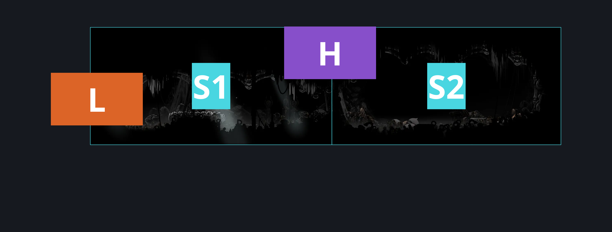
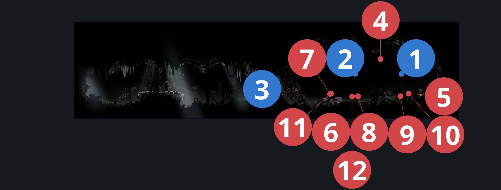
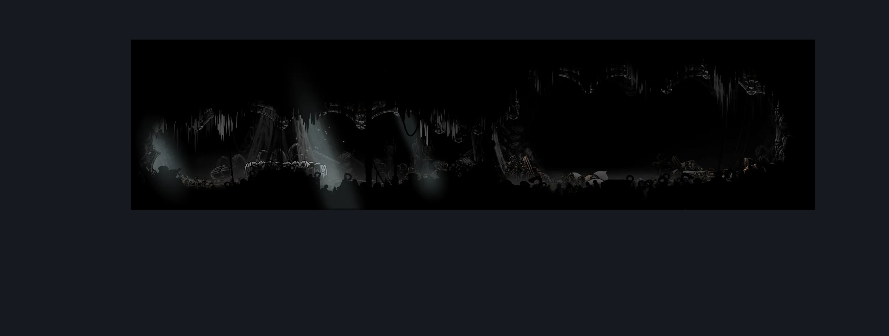

# Whiteward Sherma Gauntlet (Ward_09)

**Game ID:** Ward_09

**Contributors:** skai, Gallos

## Subrooms

| No. | Subroom | Annotated |
| --- | --- | --- |
| S1 | entry | ✓ |
| S2 | arena | ✓ |

## Room Transitions

| Alias | Name | From subroom | Destination | Destination alias | Requirements | TODO | Verification | Annotated | Notes |
| --- | --- | --- | --- | --- | --- | --- | --- | --- | --- |
| L | Left | entry | [Whiteward Descent Connection (Ward_03)](whiteward-descent-connection.md) | SG | Nothing |  | Verified | ✓ |  |

## Subroom Connections

| Alias | Name | Source | Destination | Requirements | TODO | Verification | Annotated | Notes |
| --- | --- | --- | --- | --- | --- | --- | --- | --- |
| H | horizontal | entry | arena | clear Sherma Gauntlet Wall |  | Verified | ✓ |  |
| H | horizontal | arena | entry | clear Sherma Gauntlet Wall |  | Verified | ✓ |  |

## Check Locations

| No. | Check | Subroom | Requirements | TODO | Verification | Location Type | Annotated | Notes |
| --- | --- | --- | --- | --- | --- | --- | --- | --- |
| 1 | Balm for the Wounded Wish Granted | arena | Defeat Balm for the Wounded Gauntlet |  | Verified | event | ✓ |  |
| 2 | Balm for the Wounded - Spool Fragment | arena | Complete Balm for the Wounded Wish Granted |  | Verified | collectible | ✓ | Completion for the wish. |
| 3 | Sherma Gauntlet Wall | entry | break wall right |  | Verified | blockade | ✓ |  |
| 4 | Balm for the Wounded Gauntlet | arena | Combat Requirements |  | Verified | gauntlet | ✓ | Completion for the wish. |
| 5 | Surgeon 1 | arena | Black Thread World Spawn AND Defeat Balm for the Wounded Gauntlet |  | Verified | enemy | ✓ | natural spawn after wish |
| 6 | Surgeon 2 | arena | Black Thread World Spawn AND Defeat Balm for the Wounded Gauntlet |  | Verified | enemy | ✓ | natural spawn after wish |
| 7 | Mortician 1 | arena | none |  | Verified | enemy | ✓ | second to spawn |
| 8 | Mortician 2 | arena | none |  | Verified | enemy | ✓ | third to spawn |
| 9 | Surgeon 3 | arena | none |  | Verified | enemy | ✓ | fourth to spawn |
| 10 | Surgeon 4 | arena | none |  | Verified | enemy | ✓ | first to spawn |
| 11 | Surgeon 5 | arena | none |  | Verified | enemy | ✓ | fifth to spawn |
| 12 | Surgeon 6 | arena | invalid |  | Verified | enemy | ✓ | dummy |

## Room Images

### Connections

### Checks

### Scene

