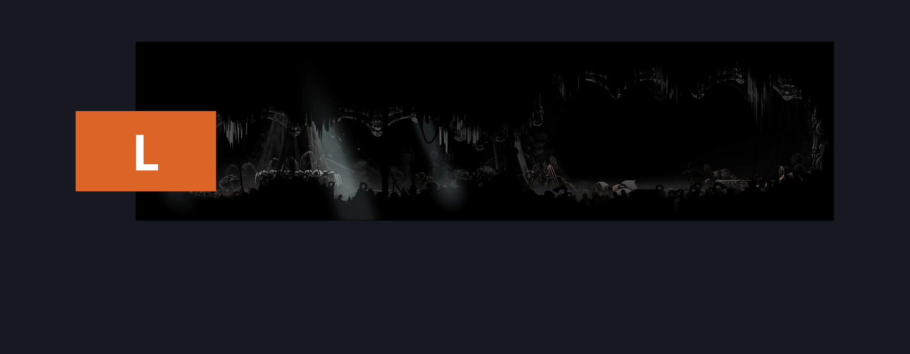
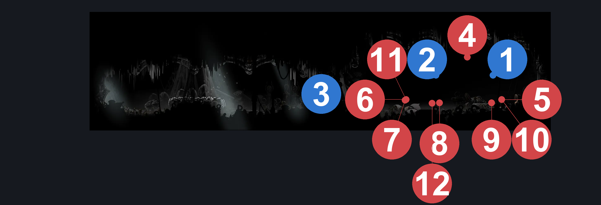
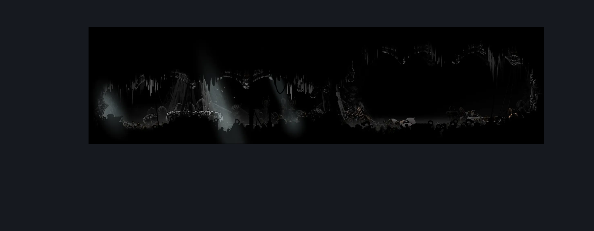

# Whiteward Sherma Gauntlet (Ward_09)

**Game ID:** Ward_09

**Contributors:** skai

## Subrooms

No subrooms defined.

## Room Transitions

| Alias | Name | From subroom | Destination | Destination alias | Requirements | TODO | Verification | Annotated | Notes |
| --- | --- | --- | --- | --- | --- | --- | --- | --- | --- |
| L | Left |  | [Whiteward Descent Connection (Ward_03)](whiteward-descent-connection.md) | SG | Nothing |  | Verified | ✓ |  |

## Subroom Connections

No subroom connections defined.

## Check Locations

| No. | Check | Subroom | Requirements | TODO | Verification | Location Type | Annotated | Notes |
| --- | --- | --- | --- | --- | --- | --- | --- | --- |
| 1 | Balm for the Wounded Wish Granted |  | Defeat Balm for the Wounded Gauntlet |  | Verified | event | ✓ |  |
| 2 | Balm for the Wounded - Spool Fragment |  | Complete Balm for the Wounded Wish Granted |  | Verified | collectible | ✓ | Completion for the wish. |
| 3 | Sherma Gauntlet Wall |  | break wall right |  | Verified | blockade | ✓ |  |
| 4 | Balm for the Wounded Gauntlet |  | Combat Requirements |  | Verified | gauntlet | ✓ | Completion for the wish. |
| 5 | Surgeon 1 |  | ACT 3 |  | Verified | enemy | ✓ | spawning before talking to sherma |
| 6 | Surgeon 2 |  | ACT 3 |  | Verified | enemy | ✓ | spawning before talking to sherma |
| 7 | Surgeon 3 |  | none |  | Verified | enemy | ✓ | fourth to spawn |
| 8 | Mortician 1 |  | none |  | Verified | enemy | ✓ | second to spawn |
| 9 | Mortician 2 |  | none |  | Verified | enemy | ✓ | third to spawn |
| 10 | Surgeon 4 |  | none |  | Verified | enemy | ✓ | first to spawn |
| 11 | Surgeon 5 |  | none |  | Verified | enemy | ✓ | fourth to spawn |
| 12 | Surgeon 6 |  | invalid |  | Verified | enemy | ✓ | dummy |

## Room Images

### Connections

### Checks

### Scene

