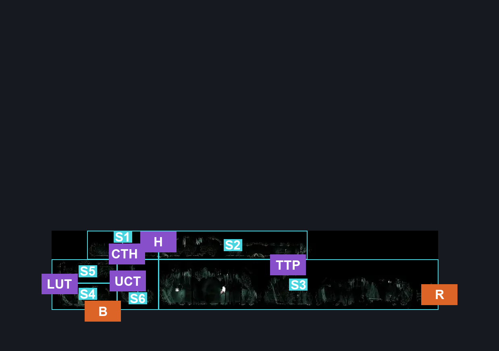
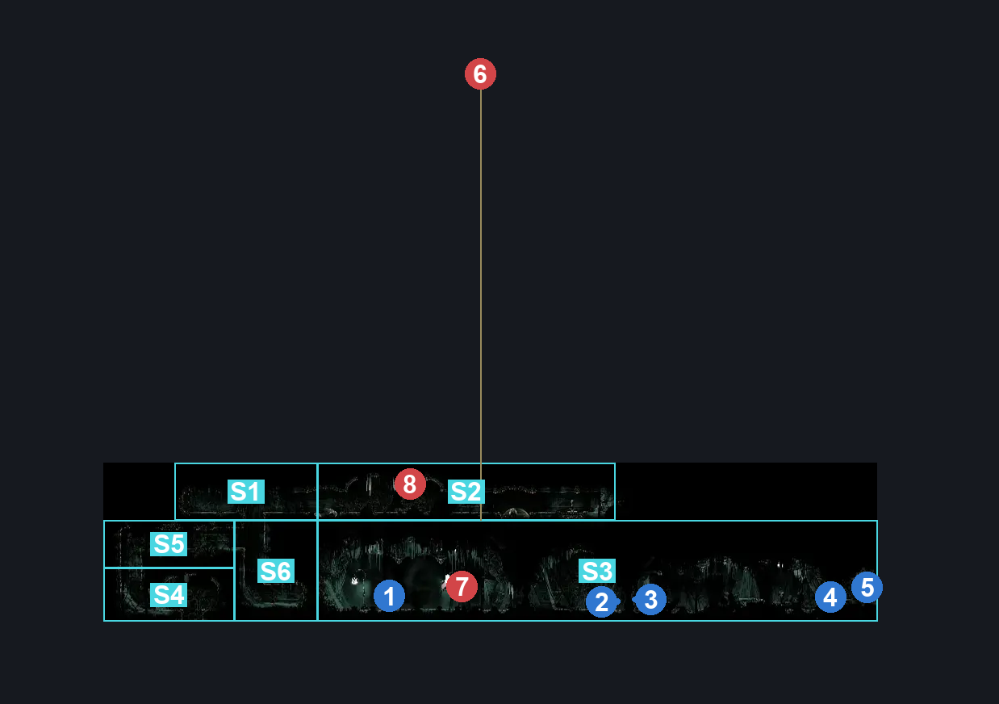
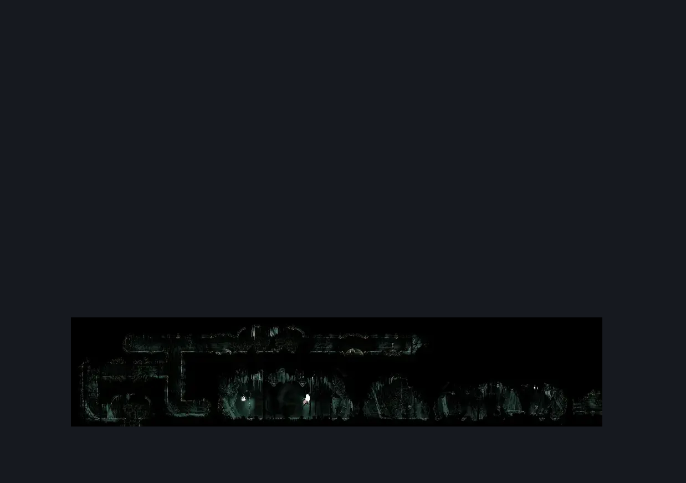

# Whiteward Tunnel Room (Ward_02b)

**Game ID:** Ward_02b

**Contributors:** skai, Gallos

## Subrooms

| No. | Subroom | Annotated |
| --- | --- | --- |
| S1 | Top Horizontal left | ✓ |
| S2 | Top Horizontal right | ✓ |
| S3 | Pickup Section | ✓ |
| S4 | Lower Tunnels | ✓ |
| S5 | Upper Tunnels | ✓ |
| S6 | Center Tunnels | ✓ |

## Room Transitions

| Alias | Name | From subroom | Destination | Destination alias | Requirements | TODO | Verification | Annotated | Notes |
| --- | --- | --- | --- | --- | --- | --- | --- | --- | --- |
| B | Bottom | Lower Tunnels | [Whiteward Unravelled Arena Room (Ward_02)](whiteward-unravelled-arena-room.md) | T | Nothing |  | Verified | ✓ |  |
| R | Right | Pickup Section | [Whiteward Entrance (Ward_01)](whiteward-entrance.md) | ML | clear Whiteward Tunnel Room - Wall 4 |  | Verified | ✓ | There are four walls. |

## Subroom Connections

| Alias | Name | Source | Destination | Requirements | TODO | Verification | Annotated | Notes |
| --- | --- | --- | --- | --- | --- | --- | --- | --- |
| LUT | Lower to Upper Tunnels | Lower Tunnels | Upper Tunnels | Cling Grip either OR easy Scuttlebrace OR Silk Soar |  | Verified | ✓ |  |
| LUT | Lower to Upper Tunnels | Upper Tunnels | Lower Tunnels | Nothing (Falling) |  | Verified | ✓ |  |
| UCT | Upper to Center Tunnels | Center Tunnels | Upper Tunnels | Cling Grip either OR easy Scuttlebrace OR Silk Soar |  | Verified | ✓ |  |
| UCT | Upper to Center Tunnels | Upper Tunnels | Center Tunnels | Nothing (Falling) |  | Verified | ✓ |  |
| CTH | Center to Top Horizontal | Center Tunnels | Top Horizontal left | Cling Grip either OR easy Scuttlebrace OR Silk Soar |  | Verified | ✓ |  |
| CTH | Center to Top Horizontal | Top Horizontal left | Center Tunnels | Nothing (Falling) |  | Verified | ✓ |  |
| TTP | Top to Pickup Section | Top Horizontal right | Pickup Section | hit switch either |  | Verified | ✓ |  |
| H | horizontal | Top Horizontal left | Top Horizontal right | spike pogo OR clawline right OR dash right OR run |  | Verified | ✓ |  |
| H | horizontal | Top Horizontal right | Top Horizontal left | spike pogo OR clawline left OR dash left OR run |  | Verified | ✓ |  |

## Check Locations

| No. | Check | Subroom | Requirements | TODO | Verification | Location Type | Annotated | Notes |
| --- | --- | --- | --- | --- | --- | --- | --- | --- |
| 1 | Relic: Choral Commandment (Western Whiteward) | Pickup Section | Nothing |  | Verified | collectible | ✓ |  |
| 2 | Whiteward Tunnel Room - Wall 1 | Pickup Section | break wall right |  | Verified | blockade | ✓ |  |
| 3 | Whiteward Tunnel Room - Wall 2 | Pickup Section | break wall right |  | Verified | blockade | ✓ |  |
| 4 | Whiteward Tunnel Room - Wall 3 | Pickup Section | break wall right |  | Verified | blockade | ✓ |  |
| 5 | Whiteward Tunnel Room - Wall 4 | Pickup Section | break wall right |  | Verified | blockade | ✓ |  |
| 6 | Dreg Husk 1 | Pickup Section | invalid |  | Verified | enemy | ✓ | unused enemy |
| 7 | Dreg Husk 2 | Pickup Section | none |  | Verified | enemy | ✓ |  |
| 8 | Drapefly 1 | Top Horizontal right | none |  | Verified | enemy | ✓ |  |

## Room Images

### Connections

### Checks

### Scene

