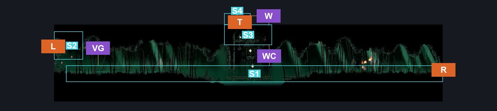
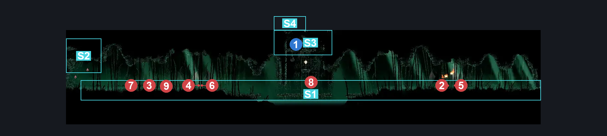
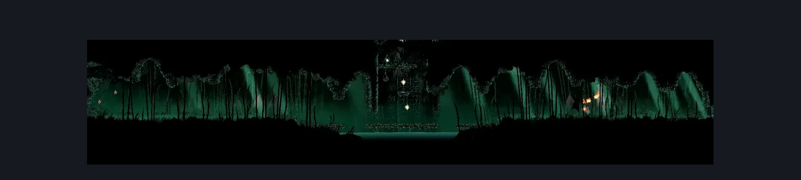

# Wisp Thicket Grounds (Wisp_02)

**Game ID:** Wisp_02

**Contributors:** samupo and Isssma

## Subrooms

| No. | Subroom | Annotated |
| --- | --- | --- |
| S1 | main path | ✓ |
| S2 | high up platform | ✓ |
| S3 | the fire tower | ✓ |
| S4 | cave diver fav spot | ✓ |

## Room Transitions

| Alias | Name | From subroom | Destination | Destination alias | Requirements | TODO | Verification | Annotated | Notes |
| --- | --- | --- | --- | --- | --- | --- | --- | --- | --- |
| T | top1 | cave diver fav spot | [Wisp Thicket Secret Path (Wisp_05)](wisp-thicket-secret-path.md) | B | nothing |  | Verified | ✓ |  |
| R | right1 | main path | [Wisp Thicket Bench (Wisp_04)](wisp-thicket-bench.md) | L | none |  | Verified | ✓ |  |
| L | left1 | high up platform | [Father of the Flame Gamer Cave (Belltown_08)](father-of-the-flame-gamer-cave.md) | R | nothing |  | Verified | ✓ |  |

## Subroom Connections

| Alias | Name | Source | Destination | Requirements | TODO | Verification | Annotated | Notes |
| --- | --- | --- | --- | --- | --- | --- | --- | --- |
| WC | wisp climb | main path | the fire tower | silk soar OR ((cling grip right  OR (faydown cloak AND ledge grab left)) AND (cling grip left OR (faydown cloak AND easy [hunter, wanderer, beast, architect, witch, shaman] pogo))) |  | Verified | ✓ |  |
| WC | wisp climb | the fire tower | main path | nothing |  | Verified | ✓ |  |
| VG | vertical gap | main path | high up platform | silk soar OR ledge grab left OR faydown cloak OR easy shaman pogo |  | Verified | ✓ |  |
| VG | vertical gap | high up platform | main path | nothing |  | Verified | ✓ |  |
| W | witchery | the fire tower | cave diver fav spot | break wall up |  | Verified | ✓ |  |
| W | witchery | cave diver fav spot | the fire tower | elite ball knowledge AND hard [hunter, wanderer, reaper, beast, architect, witch] crest bind stall AND break wall right |  | Verified | ✓ |  |

## Check Locations

| No. | Check | Subroom | Requirements | TODO | Verification | Location Type | Annotated | Notes |
| --- | --- | --- | --- | --- | --- | --- | --- | --- |
| 1 | Rosary Necklace: Wisp Thicket | the fire tower | nothing |  | Verified | collectible | ✓ |  |
| 2 | Burning Bug 1 | main path | nothing |  | Verified | enemy | ✓ | Spawn conditions: defeatedWispPyreEffigy=false |
| 3 | Burning Bug 2 | main path | nothing |  | Verified | enemy | ✓ | Spawn conditions: defeatedWispPyreEffigy=false |
| 4 | Burning Bug 3 | main path | nothing |  | Verified | enemy | ✓ | Spawn conditions: defeatedWispPyreEffigy=false |
| 5 | Farmer Wisp Immolater Variant 1 | main path | defeat Boss: Father of the Flame IN father of the flame gamer cave |  | Verified | enemy | ✓ | Spawn conditions: defeatedWispPyreEffigy=true |
| 6 | Farmer Wisp Immolater Variant (2) 1 | main path | defeat Boss: Father of the Flame IN father of the flame gamer cave |  | Verified | enemy | ✓ | Spawn conditions: defeatedWispPyreEffigy=true |
| 7 | Farmer Wisp Immolater Variant (3) 1 | main path | defeat Boss: Father of the Flame IN father of the flame gamer cave |  | Verified | enemy | ✓ | Spawn conditions: defeatedWispPyreEffigy=true |
| 8 | Wisp 1 | main path | nothing |  | Verified | enemy | ✓ | these are the wisp that spawn from the lanterns |
| 9 | Wisp 2 | main path | prereq Burning bug 1 |  | Verified | enemy | ✓ |  |

## Notes

## Room Images

### Connections

### Checks

### Scene

