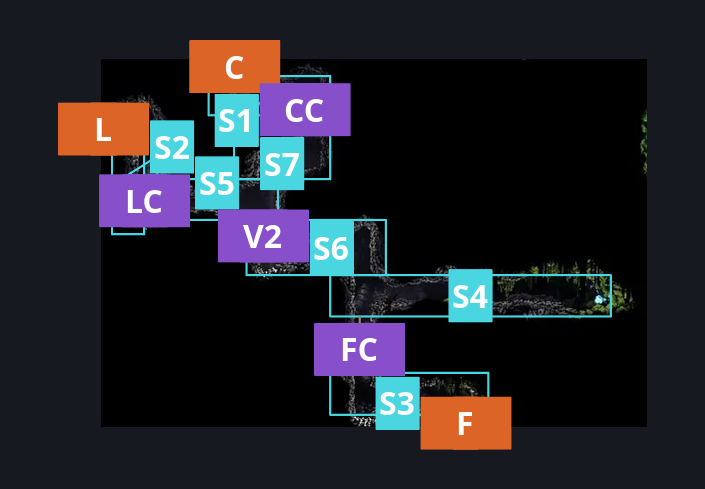
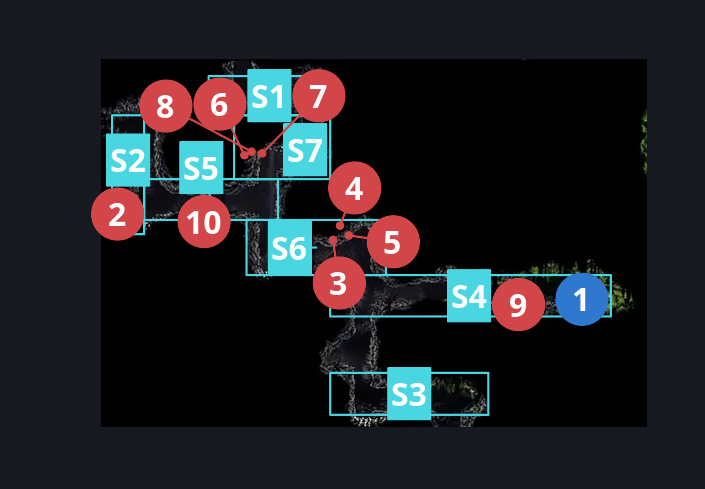
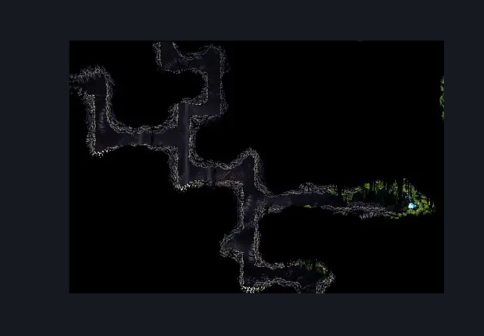

# Wormways Lower East (Crawl_07)

**Game ID:** Crawl_07

**Contributors:** herounit, cry

## Subrooms

| No. | Subroom | Annotated |
| --- | --- | --- |
| S1 | ceiling exit area | ✓ |
| S2 | left exit area | ✓ |
| S3 | floor exit area | ✓ |
| S4 | bud alcove | ✓ |
| S5 | left offshoot | ✓ |
| S6 | lower main tunnel | ✓ |
| S7 | upper main tunnel | ✓ |

## Room Transitions

| Alias | Name | From subroom | Destination | Destination alias | Requirements | TODO | Verification | Annotated | Notes |
| --- | --- | --- | --- | --- | --- | --- | --- | --- | --- |
| C | ceiling | ceiling exit area | [Wormways Middle (Crawl_03b)](wormways-middle.md) | F | none |  | Verified | ✓ |  |
| L | left | left exit area | [Wormways Lower West (Crawl_09)](wormways-lower-west.md) | R | none |  | Verified | ✓ |  |
| F | floor | floor exit area | [Bonegrave (Bonegrave)](../bone-bottom/bonegrave.md) | C | none |  | Verified | ✓ |  |

## Subroom Connections

| Alias | Name | Source | Destination | Requirements | TODO | Verification | Annotated | Notes |
| --- | --- | --- | --- | --- | --- | --- | --- | --- |
| CC | ceiling climb | upper main tunnel | ceiling exit area | cling grip either OR (faydown cloak AND (ledge grab left OR easy shaman pogo OR medium [flea brew, rune rage, thread storm] stall OR medium heal stall OR (ponder the orb AND dash right AND (easy beast pogo OR medium cross stitch stall)))) OR easy scuttlebrace  OR silk soar |  | Verified | ✓ |  |
| CC | ceiling climb | ceiling exit area | upper main tunnel | none (falling) |  | Verified | ✓ |  |
| V1 | vertical 1 | left offshoot | upper main tunnel | ledge grab right OR cling grip either OR scuttlebrace OR faydown cloak OR medium pogo off Grom |  | Verified |  |  |
| V1 | vertical 1 | upper main tunnel | left offshoot | none (falling) |  | Verified |  |  |
| LC | left climb | left offshoot | left exit area | cling grip either OR easy scuttlebrace  OR (faydown cloak AND (easy pogo off Gromling OR (ledge grab left AND (medium [flea brew, rune rage, thread storm] stall OR medium heal stall OR (ponder the orb AND dash left AND medium cross stitch stall))))) |  | Verified | ✓ |  |
| LC | left climb | left exit area | left offshoot | none (falling) |  | Verified | ✓ |  |
| V2 | vertical 2 | lower main tunnel | left offshoot | cling grip either OR easy scuttlebrace OR faydown cloak OR medium pogo off Grom |  | Verified | ✓ |  |
| V2 | vertical 2 | left offshoot | lower main tunnel | none (falling) |  | Verified | ✓ |  |
| V3 | vertical 3 | bud alcove | lower main tunnel | ledge grab left OR cling grip either OR easy scuttlebrace OR faydown cloak OR medium pogo off Grom |  | Verified |  |  |
| V3 | vertical 3 | lower main tunnel | bud alcove | none (falling) |  | Verified |  |  |
| FC | floor climb | floor exit area | bud alcove | cling grip either OR ((ledge grab both OR faydown cloak) AND (medium pogo off Grom)) OR easy scuttlebrace OR (faydown cloak AND ledge grab right) |  | Verified | ✓ |  |
| FC | floor climb | bud alcove | floor exit area | none (falling) |  | Verified | ✓ |  |

## Check Locations

| No. | Check | Subroom | Requirements | TODO | Verification | Location Type | Annotated | Notes |
| --- | --- | --- | --- | --- | --- | --- | --- | --- |
| 1 | plasmium bud lower east | bud alcove | complete THE alchemist's assistant wish promised  AND needle phial |  | Verified | resource | ✓ |  |
| 2 | Gromling 1 | left exit area | Normal World Spawn |  | Verified | enemy | ✓ |  |
| 3 | Grom 1 | lower main tunnel | Normal World Spawn |  | Verified | enemy | ✓ |  |
| 4 | Grom 2 | lower main tunnel | Normal World Spawn |  | Verified | enemy | ✓ |  |
| 5 | Grom 3 | lower main tunnel | Normal World Spawn |  | Verified | enemy | ✓ |  |
| 6 | Grom 4 | upper main tunnel | Normal World Spawn |  | Verified | enemy | ✓ |  |
| 7 | Grom 5 | upper main tunnel | Normal World Spawn |  | Verified | enemy | ✓ |  |
| 8 | Grom 6 | upper main tunnel | Normal World Spawn |  | Verified | enemy | ✓ |  |
| 9 | Plasmid 1 | bud alcove | Black Thread World Spawn |  | Verified | enemy | ✓ |  |
| 10 | Plasmid 2 | left offshoot | Black Thread World Spawn |  | Verified | enemy | ✓ |  |

## Notes

this one seems a bit tricky, but also it's just a bit late
i think you need cling grip to from any one point to another in here
TODO: review the mapping in here
cry: Most of this area can be navigated without mobility upgrades simply with pogos, every worm-spawn shaft has a blind spot on the right side hornet can hug to safely avoid the worms and pogo over, most other shafts in wormways also have a blind spot in one direction

## Room Images

### Connections

### Checks

### Scene

