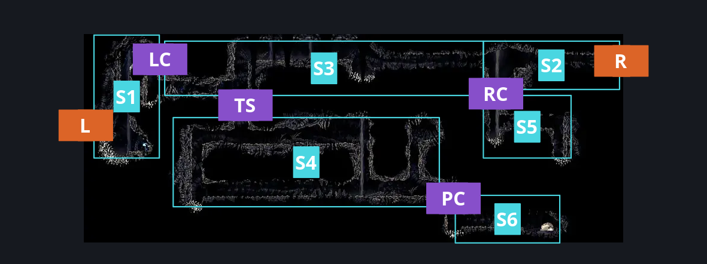
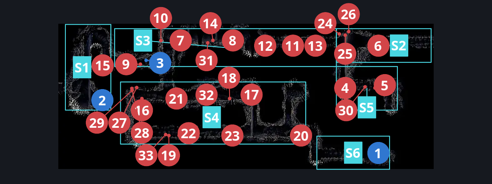
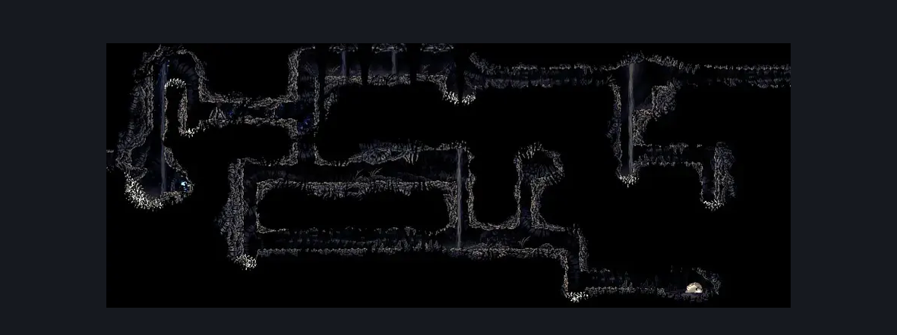

# Wormways Lower West (Crawl_09)

**Game ID:** Crawl_09

**Contributors:** herounit, cry

## Subrooms

| No. | Subroom | Annotated |
| --- | --- | --- |
| S1 | left exit shaft | ✓ |
| S2 | right exit tunnel | ✓ |
| S3 | upper tunnels | ✓ |
| S4 | lower tunnels | ✓ |
| S5 | right exit basement | ✓ |
| S6 | pilgrim tomb | ✓ |

## Room Transitions

| Alias | Name | From subroom | Destination | Destination alias | Requirements | TODO | Verification | Annotated | Notes |
| --- | --- | --- | --- | --- | --- | --- | --- | --- | --- |
| R | right | right exit tunnel | [Wormways Lower East (Crawl_07)](wormways-lower-east.md) | L | none |  | Verified | ✓ |  |
| L | left | left exit shaft | [Wormways Zango Arena (Crawl_10)](wormways-zango-arena.md) | R | break wall [left, right] |  | Verified | ✓ |  |

## Subroom Connections

| Alias | Name | Source | Destination | Requirements | TODO | Verification | Annotated | Notes |
| --- | --- | --- | --- | --- | --- | --- | --- | --- |
| LC | left climb | left exit shaft | upper tunnels | ((spike pogo OR dash right OR (proficient movement AND easy naked pogo)) AND (silk soar OR cling grip right)) OR (faydown cloak AND cling grip left) |  | Verified | ✓ |  |
| LC | left climb | upper tunnels | left exit shaft | cling grip right  OR faydown cloak  OR easy [reaper, architect, shaman, beast] pogo OR ((easy scuttlebrace OR cling grip left) AND (spike pogo OR dash left OR easy naked pogo)) OR (ponder the orb AND dash left AND medium [hunter, witch, wanderer] pogo) |  | Verified | ✓ |  |
| RC | right climb | right exit tunnel | right exit basement | none (falling) |  | Verified | ✓ |  |
| RC | right climb | right exit basement | right exit tunnel | cling grip either  OR easy scuttlebrace  OR easy enemy pogo |  | Verified | ✓ |  |
| TS | tunnel shaft | lower tunnels | upper tunnels | silk soar  OR easy scuttlebrace  OR cling grip either  OR (ponder the orb AND faydown cloak AND ledge grab left AND dash either AND (medium flea brew stall x 2 OR (medium heal stall AND have crest beast))) |  | Verified | ✓ |  |
| TS | tunnel shaft | upper tunnels | lower tunnels | none (falling) |  | Verified | ✓ |  |
| TC | tunnel connector | right exit tunnel | upper tunnels | none |  | Verified |  |  |
| TC | tunnel connector | upper tunnels | right exit tunnel | none |  | Verified |  |  |
| PC | pilgrim crevace | lower tunnels | pilgrim tomb | none (falling) |  | Verified | ✓ |  |
| PC | pilgrim crevace | pilgrim tomb | lower tunnels | cling grip either OR easy scuttlebrace OR faydown cloak |  | Verified | ✓ |  |

## Check Locations

| No. | Check | Subroom | Requirements | TODO | Verification | Location Type | Annotated | Notes |
| --- | --- | --- | --- | --- | --- | --- | --- | --- |
| 1 | wormways memory locket | pilgrim tomb | none |  | Verified | collectible | ✓ |  |
| 2 | plasmium bud lower west | left exit shaft | complete THE alchemist's assistant wish promised  AND needle phial |  | Verified | collectible | ✓ |  |
| 3 | Breakable Mid Wall | upper tunnels | needle {right} OR needle {left} |  | Verified | blockade | ✓ | the area behind this wall will remain in the dark until broken |
| 4 | Gromling 1 | right exit basement | Normal World Spawn |  | Verified | enemy | ✓ |  |
| 5 | Gromling 2 | right exit basement | Normal World Spawn |  | Verified | enemy | ✓ |  |
| 6 | Gromling 3 | right exit tunnel | Normal World Spawn |  | Verified | enemy | ✓ |  |
| 7 | Gromling 4 | upper tunnels | Normal World Spawn |  | Verified | enemy | ✓ |  |
| 8 | Gromling 5 | upper tunnels | Normal World Spawn |  | Verified | enemy | ✓ |  |
| 9 | Gromling 6 | upper tunnels | Normal World Spawn |  | Verified | enemy | ✓ |  |
| 10 | Gromling 7 | upper tunnels | Normal World Spawn |  | Verified | enemy | ✓ |  |
| 11 | Gromling 8 | upper tunnels | Normal World Spawn |  | Verified | enemy | ✓ |  |
| 12 | Gromling 9 | upper tunnels | Normal World Spawn |  | Verified | enemy | ✓ |  |
| 13 | Gromling 10 | upper tunnels | Normal World Spawn |  | Verified | enemy | ✓ |  |
| 14 | Gromling 11 | upper tunnels | Normal World Spawn |  | Verified | enemy | ✓ |  |
| 15 | Gromling 12 | left exit shaft | Normal World Spawn |  | Verified | enemy | ✓ |  |
| 16 | Gromling 13 | lower tunnels | Normal World Spawn |  | Verified | enemy | ✓ |  |
| 17 | Gromling 14 | lower tunnels | Normal World Spawn |  | Verified | enemy | ✓ |  |
| 18 | Gromling 15 | lower tunnels | Normal World Spawn |  | Verified | enemy | ✓ |  |
| 19 | Gromling 16 | lower tunnels | Normal World Spawn |  | Verified | enemy | ✓ |  |
| 20 | Gromling 17 | lower tunnels | Normal World Spawn |  | Verified | enemy | ✓ |  |
| 21 | Gromling 18 | lower tunnels | Normal World Spawn |  | Verified | enemy | ✓ |  |
| 22 | Gromling 19 | lower tunnels | Normal World Spawn |  | Verified | enemy | ✓ |  |
| 23 | Gromling 20 | lower tunnels | Normal World Spawn |  | Verified | enemy | ✓ |  |
| 24 | Grom 1 | right exit tunnel | Normal World Spawn |  | Verified | enemy | ✓ |  |
| 25 | Grom 2 | right exit tunnel | Normal World Spawn |  | Verified | enemy | ✓ |  |
| 26 | Grom 3 | right exit tunnel | Normal World Spawn |  | Verified | enemy | ✓ |  |
| 27 | Grom 4 | lower tunnels | Normal World Spawn |  | Verified | enemy | ✓ |  |
| 28 | Grom 5 | lower tunnels | Normal World Spawn |  | Verified | enemy | ✓ |  |
| 29 | Grom 6 | lower tunnels | Normal World Spawn |  | Verified | enemy | ✓ |  |
| 30 | Plasmid 1 | right exit basement | Black Thread World Spawn |  | Verified | enemy | ✓ |  |
| 31 | Plasmid 2 | upper tunnels | Black Thread World Spawn |  | Verified | enemy | ✓ |  |
| 32 | Plasmid 3 | lower tunnels | Black Thread World Spawn |  | Verified | enemy | ✓ |  |
| 33 | Plasmid 4 | lower tunnels | Black Thread World Spawn |  | Verified | enemy | ✓ |  |

## Notes

this one seems a bit tricky, but also it's just a bit late
i think you need cling grip to from any one point to another in here
TODO: review the mapping in here
cry: wasn't sure how to mark the second markable wall in this room, there's one at the left exit and one right before the climb connecting to the tunnel network -- the full area behind this second wall is left in the dark until that wall is broken; worth noting since you will have to navigate to it blindly in future room rando if you first enter this room from the left entrance

## Room Images

### Connections

### Checks

### Scene

