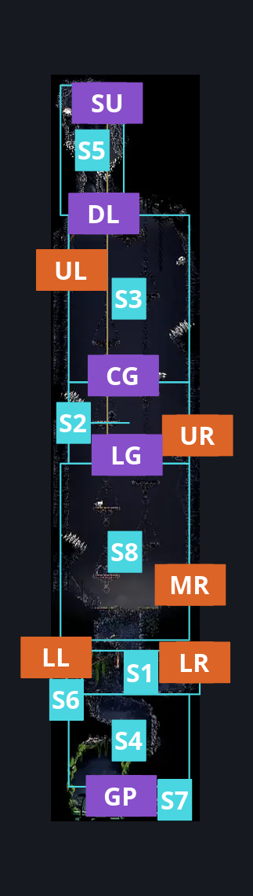
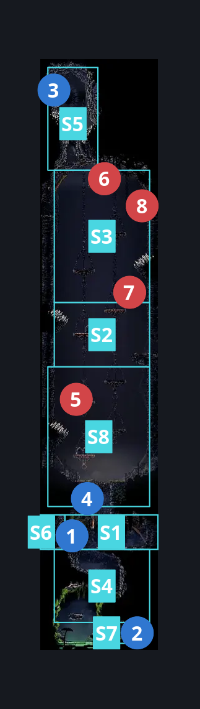
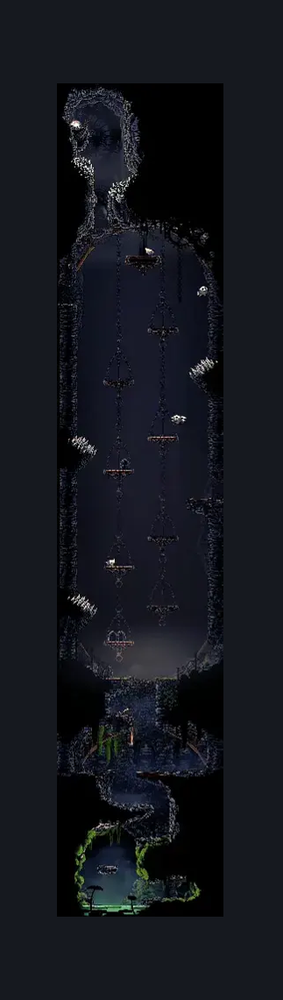

# Wormways Shaft (Crawl_02)

**Game ID:** Crawl_02

**Contributors:** herounit, cry

## Subrooms

| No. | Subroom | Annotated |
| --- | --- | --- |
| S1 | entrance tunnel | ✓ |
| S2 | middle platform area | ✓ |
| S3 | upper platform area | ✓ |
| S4 | mask grotto | ✓ |
| S5 | rosary duct | ✓ |
| S6 | behind door | ✓ |
| S7 | mask crevace | ✓ |
| S8 | lower platform area | ✓ |

## Room Transitions

| Alias | Name | From subroom | Destination | Destination alias | Requirements | TODO | Verification | Annotated | Notes |
| --- | --- | --- | --- | --- | --- | --- | --- | --- | --- |
| LR | lower right | entrance tunnel | [Wormways Craggler Hallway (Crawl_04)](wormways-craggler-hallway.md) | L | none |  | Verified | ✓ |  |
| LL | lower left | behind door | [Wormways Middle (Crawl_03b)](wormways-middle.md) | R | none |  | Verified | ✓ | there's a pocket of air behind the door and it is not enforced on the other side |
| UL | upper left | upper platform area | [Wormways Upper West (Crawl_03)](wormways-upper-west.md) | R | clear shaft wall blockade IN Wormways Upper West |  | Verified | ✓ |  |
| UR | upper right | middle platform area | [Wormways Upper East (Crawl_01)](wormways-upper-east.md) | L | none |  | Verified | ✓ |  |
| MR | middle right | lower platform area | [Wormways Flea Rescue (Crawl_06)](wormways-flea-rescue.md) | L | break wall {right} |  | Verified | ✓ | unsafe arrival without wall broken |

## Subroom Connections

| Alias | Name | Source | Destination | Requirements | TODO | Verification | Annotated | Notes |
| --- | --- | --- | --- | --- | --- | --- | --- | --- |
| DS | door switch | lower platform area | entrance tunnel | none (door switch is on this side) |  | Verified |  | This syntax can easily make some checks incorrectly in logic if not touched before adding lever rando. |
| DS | door switch | entrance tunnel | lower platform area | activate Wormways Shaft - Shaft Shortcut Hatch Lever AND (cling grip left OR ((ledge grab left OR cling grip right) AND faydown cloak)  OR easy scuttlebrace  OR silk soar) |  | Verified |  |  |
| CG | platform gaps | middle platform area | upper platform area | silk soar  OR cling grip left OR easy scuttlebrace OR (faydown cloak AND (easy [shaman, reaper, architect, beast] pogo OR  ledge grab left OR (ponder the orb AND dash right AND medium [hunter, witch] pogo))) OR (cling grip right AND spike pogo AND (easy [shaman, reaper, architect, beast] pogo OR medium [hunter, witch, wanderer] pogo)) |  | Verified | ✓ |  |
| CG | platform gaps | upper platform area | middle platform area | none (falling) |  | Verified | ✓ |  |
| GT | grotto tunnel | entrance tunnel | mask grotto | none (falling) |  | Verified |  |  |
| GT | grotto tunnel | mask grotto | entrance tunnel | ledge grab left  OR cling grip either  OR faydown cloak  OR easy scuttlebrace  OR silk soar |  | Verified |  |  |
| DL | duct ledge | upper platform area | rosary duct | cling grip either OR scuttlebrace OR ((faydown cloak AND (easy pogo off Winged Pilgrim OR medium pogo off Winged Pilgrim Bellbearer ) AND spike pogo)) |  | Verified | ✓ |  |
| DL | duct ledge | rosary duct | upper platform area | none (falling) |  | Verified | ✓ |  |
| SK | simple key lock | entrance tunnel | behind door | unlock Wormways Simple Lock |  | Verified |  |  |
| SK | simple key lock | behind door | entrance tunnel | unlock Wormways Simple Lock |  | Verified |  |  |
| SU | silk up | lower platform area | rosary duct | silk soar |  | Verified | ✓ | inverse connection would just go through other subrooms, redundant |
| GP | grotto pool | mask crevace | mask grotto | ledge grab left OR cling grip left OR faydown cloak  OR easy shaman pogo OR ((cling grip right OR ledge grab right) AND (swim  OR run  OR dash left OR drifter's cloak OR clawline left  OR sharp dart  OR easy beast pogo OR easy architect needle strike)) OR easy beast needle strike |  | Verified | ✓ |  |
| GP | grotto pool | mask grotto | mask crevace | break wall right |  | Verified | ✓ |  |
| LG | lower platform gaps | lower platform area | middle platform area | ledge grab both OR cling grip right OR ((ledge grab right OR cling grip left) AND (easy [shaman, reaper, architect, beast, witch, wanderer] pogo OR medium hunter pogo)) OR silk soar OR faydown cloak |  | Verified | ✓ |  |
| LG | lower platform gaps | middle platform area | lower platform area | none (falling) |  | Verified | ✓ |  |

## Check Locations

| No. | Check | Subroom | Requirements | TODO | Verification | Location Type | Annotated | Notes |
| --- | --- | --- | --- | --- | --- | --- | --- | --- |
| 1 | Wormways Simple Lock | entrance tunnel | have Simple Key Wormways |  | Verified | lock | ✓ | unlocks the LL room exit |
| 2 | Wormways Shaft - Mask Shard | mask crevace | none |  | Verified | collectible | ✓ | formerly mask shard wormways logic should correctly reflect escaping this shard's subroom with swim logic now |
| 3 | Wormways Shaft - Unheard Prayer's Rosary String | rosary duct | none |  | Verified | collectible | ✓ | formerly frayed rosary string wormways |
| 4 | Wormways Shaft - Shaft Shortcut Hatch Lever | lower platform area | flip switch down |  | Verified | switch | ✓ | unlocks the middle/lower shortcut formerly flip door switch |
| 5 | Winged Pilgrim 1 | lower platform area | none |  | Verified | enemy | ✓ |  |
| 6 | Winged Pilgrim 2 | upper platform area | none |  | Verified | enemy | ✓ |  |
| 7 | Winged Pilgrim Bellbearer 1 | upper platform area | none |  | Verified | enemy | ✓ |  |
| 8 | Winged Pilgrim Bellbearer 2 | upper platform area | none |  | Verified | enemy | ✓ |  |

## Room Images

### Connections

### Checks

### Scene

