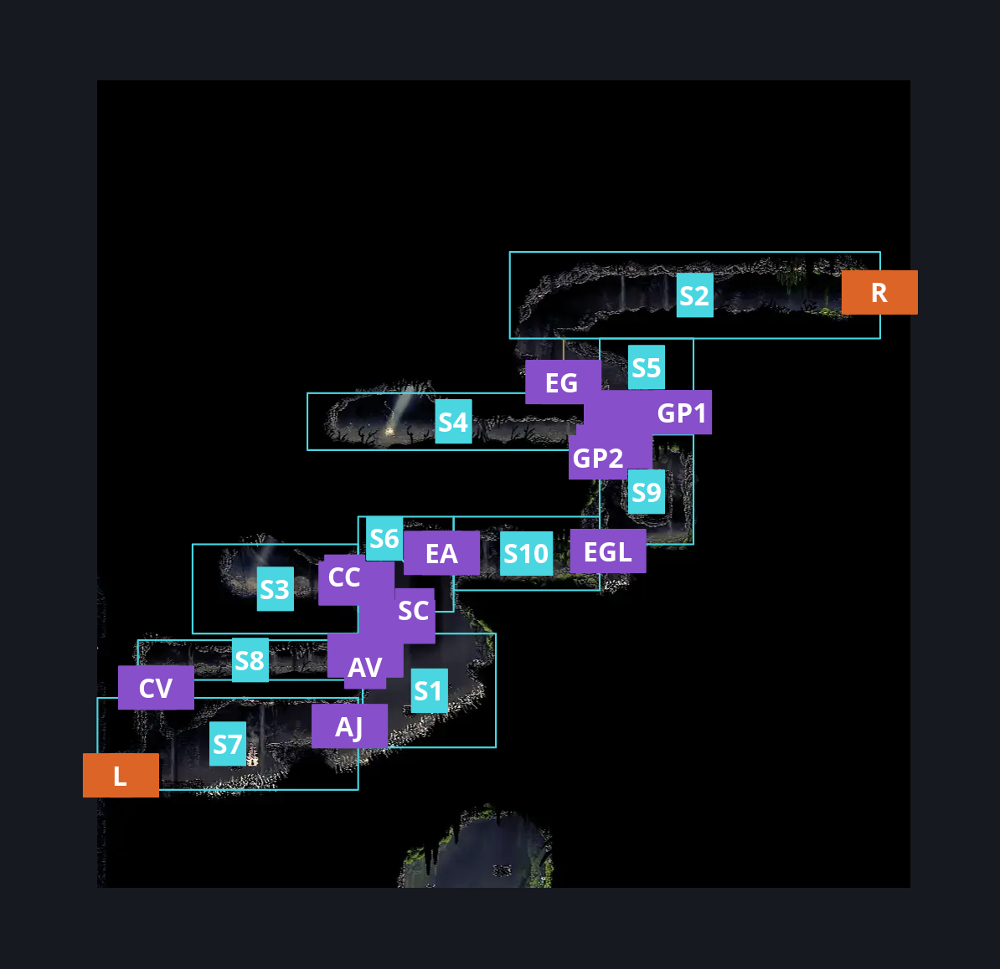
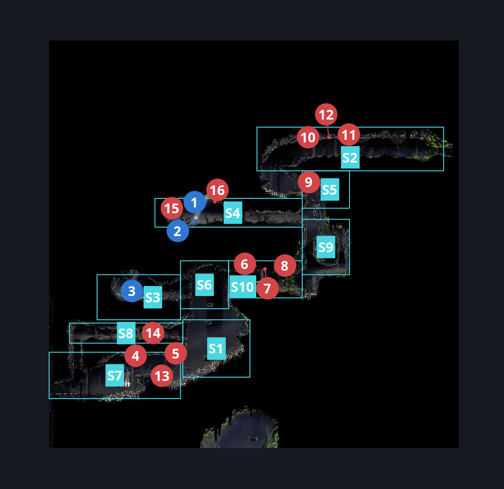
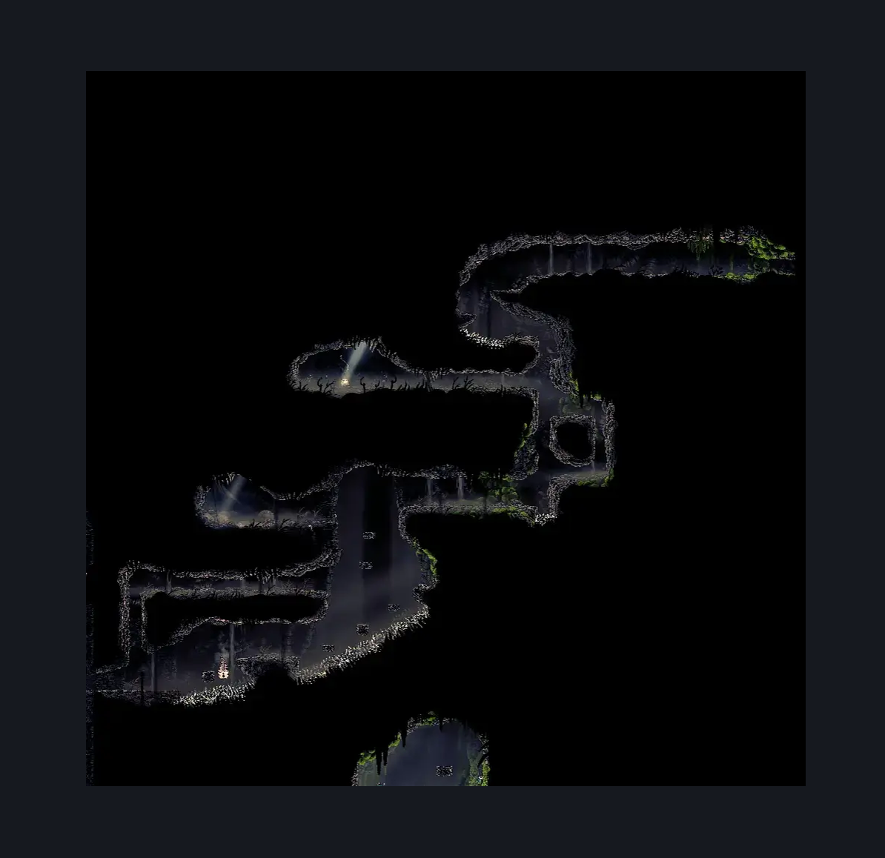

# Wormways Upper East (Crawl_01)

**Game ID:** Crawl_01

**Contributors:** herounit, cry

## Subrooms

| No. | Subroom | Annotated |
| --- | --- | --- |
| S1 | spike abyss | ✓ |
| S2 | upper exit tunnel | ✓ |
| S3 | shakra camp | ✓ |
| S4 | pilgrim grave | ✓ |
| S5 | central elevator upper | ✓ |
| S6 | abyss crossing | ✓ |
| S7 | spike abyss exit | ✓ |
| S8 | shakra camp crawlspace | ✓ |
| S9 | central elevator lower | ✓ |
| S10 | elevator passage | ✓ |

## Room Transitions

| Alias | Name | From subroom | Destination | Destination alias | Requirements | TODO | Verification | Annotated | Notes |
| --- | --- | --- | --- | --- | --- | --- | --- | --- | --- |
| L | left | spike abyss exit | [Wormways Shaft (Crawl_02)](wormways-shaft.md) | UR | none |  | Verified | ✓ |  |
| R | right | upper exit tunnel | [The Big Fall (Aspid_01)](../bone-bottom/the-big-fall.md) | UL | none |  | Verified | ✓ |  |

## Subroom Connections

| Alias | Name | Source | Destination | Requirements | TODO | Verification | Annotated | Notes |
| --- | --- | --- | --- | --- | --- | --- | --- | --- |
| EG | elevator gap | central elevator upper | upper exit tunnel | ledge grab left  OR spike pogo  OR run  OR dash left  OR cling grip left  OR drifter's cloak  OR faydown cloak  OR sharpdart  OR clawline left OR flea brew OR easy [rune rage, thread storm, pale nails, cross stitch] stall OR easy heal stall OR architect slash left OR proficient movement |  | Verified | ✓ |  |
| EG | elevator gap | upper exit tunnel | central elevator upper | none (falling) |  | Verified | ✓ |  |
| SC | camp abyss climb | abyss crossing | spike abyss | none (falling) |  | Verified | ✓ |  |
| SC | camp abyss climb | spike abyss | abyss crossing | ((ledge grab right OR cling grip right)  AND (run OR dash left OR easy [shaman, beast] pogo OR clawline left OR drifter's cloak)) OR (proficient movement AND cling grip both)  OR faydown cloak  OR medium scuttlebrace  OR (cling grip left AND (clawline left OR sharpdart OR easy architect needle strike OR easy beast pogo OR drifter's cloak))  OR silk soar |  | Verified | ✓ |  |
| EA | elevator abyss cross | abyss crossing | elevator passage | ledge grab right  OR run OR dash right OR cling grip right  OR faydown cloak  OR scuttlebrace  OR easy beast pogo  OR easy [beast, architect] needle strike OR clawline right  OR sharpdart  OR drifter's cloak |  | Verified | ✓ |  |
| EA | elevator abyss cross | elevator passage | abyss crossing | none (falling) |  | Verified | ✓ |  |
| GP1 | grave passage 1 | central elevator upper | pilgrim grave | none (falling) |  | Verified | ✓ |  |
| GP1 | grave passage 1 | pilgrim grave | central elevator upper | ledge grab right  OR cling grip either  OR silk soar  OR (easy pogo off Grom AND (easy [hunter, shaman, wanderer, witch, beast] pogo OR medium architect pogo OR hard reaper pogo)) OR easy scuttlebrace  OR faydown cloak |  | Verified | ✓ |  |
| CC | camp crossing | shakra camp | abyss crossing | none |  | Verified | ✓ |  |
| CC | camp crossing | abyss crossing | shakra camp | none |  | Verified | ✓ |  |
| AJ | abyss joint | spike abyss exit | spike abyss | none (jumping) |  | Verified | ✓ |  |
| AJ | abyss joint | spike abyss | spike abyss exit | none (falling) |  | Verified | ✓ |  |
| CV | crawlspace vent | spike abyss exit | shakra camp crawlspace | silk soar OR cling grip left  OR (faydown AND cling grip right) OR (easy scuttlebrace AND (medium [flea brew, thread storm, rune rage] stall OR medium heal stall OR faydown cloak)) |  | Verified | ✓ |  |
| CV | crawlspace vent | shakra camp crawlspace | spike abyss exit | none (falling) |  | Verified | ✓ |  |
| GP2 | grave passage 2 | central elevator lower | pilgrim grave | ledge grab both OR cling grip either  OR (silk soar AND (ledge grab left OR easy pogo off Grom)) OR (easy pogo off Grom AND (easy [hunter, shaman, wanderer, witch, beast] pogo OR medium architect pogo OR hard reaper pogo)) OR easy scuttlebrace  OR faydown cloak |  | Verified | ✓ |  |
| GP2 | grave passage 2 | pilgrim grave | central elevator lower | none (falling) |  | Verified | ✓ |  |
| AV | abyss vent | shakra camp crawlspace | spike abyss | none |  | Verified | ✓ |  |
| AV | abyss vent | spike abyss | shakra camp crawlspace | faydown cloak OR cling grip left OR easy scuttlebrace |  | Verified | ✓ |  |
| EGL | elevator gap lower | elevator passage | central elevator lower | ledge grab right  OR cling grip right  OR faydown cloak  OR easy scuttlebrace  OR easy pogo off Grom |  | Verified | ✓ |  |
| EGL | elevator gap lower | central elevator lower | elevator passage | none (falling) |  | Verified | ✓ |  |

## Check Locations

| No. | Check | Subroom | Requirements | TODO | Verification | Location Type | Annotated | Notes |
| --- | --- | --- | --- | --- | --- | --- | --- | --- |
| 1 | dead bugs purse | pilgrim grave | steel soul off |  | Verified | collectible | ✓ | STILL MARKED AS ??? ON TRACKER |
| 2 | shell satchel | pilgrim grave | steel soul on |  | Verified | collectible | ✓ |  |
| 3 | wormways map | shakra camp | spend 70 rosaries |  | Verified | collectible | ✓ | shakra shop |
| 4 | Grom 1 | spike abyss exit | none |  | Verified | enemy | ✓ |  |
| 5 | Grom 2 | spike abyss exit | none |  | Verified | enemy | ✓ |  |
| 6 | Grom 3 | elevator passage | none |  | Verified | enemy | ✓ |  |
| 7 | Grom 4 | elevator passage | none |  | Verified | enemy | ✓ |  |
| 8 | Grom 5 | elevator passage | none |  | Verified | enemy | ✓ |  |
| 9 | Grom 6 | central elevator upper | none |  | Verified | enemy | ✓ |  |
| 10 | Grom 7 | upper exit tunnel | none |  | Verified | enemy | ✓ |  |
| 11 | Grom 8 | upper exit tunnel | none |  | Verified | enemy | ✓ |  |
| 12 | Grom 9 | upper exit tunnel | none |  | Verified | enemy | ✓ |  |
| 13 | Gromling 1 | spike abyss exit | none |  | Verified | enemy | ✓ | inactive normally, but will activate if crawlspace gromling falls down into this subroom |
| 14 | Gromling 4 | shakra camp crawlspace | none |  | Verified | enemy | ✓ |  |
| 15 | Gromling 8 | pilgrim grave | none |  | Verified | enemy | ✓ |  |
| 16 | Gromling 9 | pilgrim grave | none |  | Verified | enemy | ✓ |  |

## Notes

cry: elevator abyss cross is one and done if entered from above without the requirements to climb back up the abyss
11/14 cry: this is one of the few rooms in Wormways unaffected by Act 3, relevant for journal and soul rando if someone missed Gromlings which no longer spawn anywhere else in Act 3

## Room Images

### Connections

### Checks

### Scene

