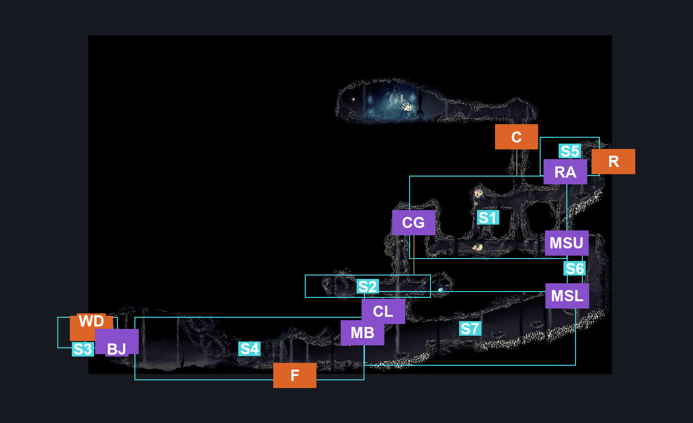
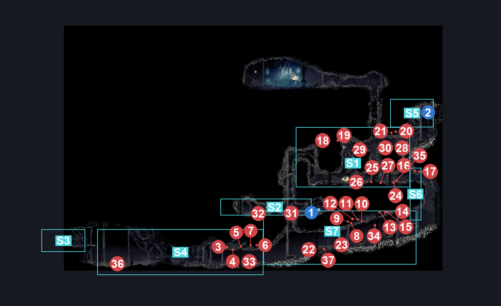
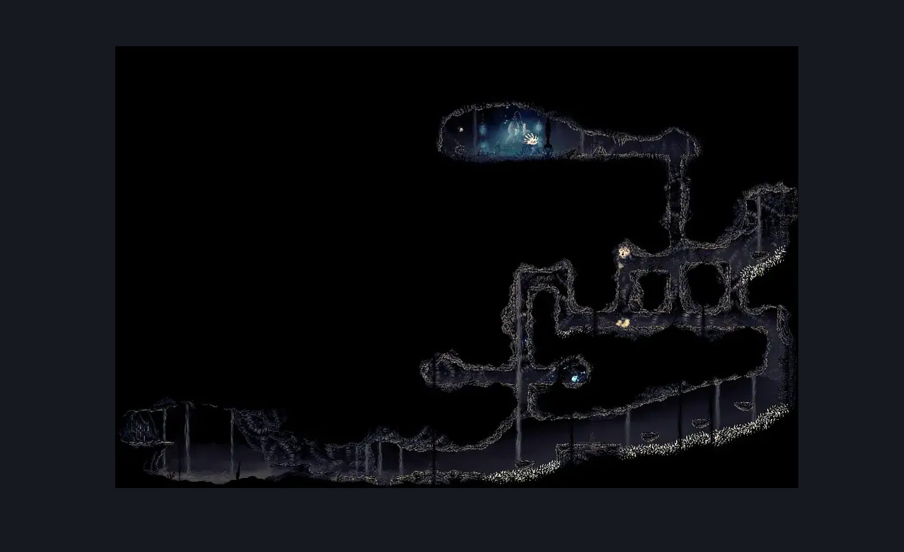

# Wormways Upper West (Crawl_03)

**Game ID:** Crawl_03

**Contributors:** herounit, cry

## Subrooms

| No. | Subroom | Annotated |
| --- | --- | --- |
| S1 | Main Tunnel Upper | ✓ |
| S2 | plasmium alcove | ✓ |
| S3 | weavenest landing | ✓ |
| S4 | Main Tunnel Lower West | ✓ |
| S5 | right exit area | ✓ |
| S6 | worm drop | ✓ |
| S7 | Main Tunnel Spike Climb | ✓ |

- **Main Tunnel Upper:** formerly main area upper
- **Main Tunnel Lower West:** formerly main tunnel lower

## Room Transitions

| Alias | Name | From subroom | Destination | Destination alias | Requirements | TODO | Verification | Annotated | Notes |
| --- | --- | --- | --- | --- | --- | --- | --- | --- | --- |
| F | floor | Main Tunnel Lower West | [Wormways Middle (Crawl_03b)](wormways-middle.md) | C | none |  | Verified | ✓ |  |
| R | right | right exit area | [Wormways Shaft (Crawl_02)](wormways-shaft.md) | UL | clear shaft wall blockade |  | Verified | ✓ |  |
| C | ceiling | Main Tunnel Upper | [Wormways Laboratory (Crawl_08)](wormways-laboratory.md) | F | silk soar OR cling grip OR scuttlebrace |  | Verified | ✓ |  |
| WD | weaver door | weavenest landing | [Wormways Weavenest (Crawl_05)](wormways-weavenest.md) | WD | needolin |  | Verified | ✓ |  |

## Subroom Connections

| Alias | Name | Source | Destination | Requirements | TODO | Verification | Annotated | Notes |
| --- | --- | --- | --- | --- | --- | --- | --- | --- |
| CG | upper climb | Main Tunnel Upper | plasmium alcove | (ledge grab AND (cling grip OR faydown cloak OR scuttlebrace)) OR (cling grip OR scuttlebrace OR (faydown cloak AND easy shaman pogo)) |  | Verified | ✓ |  |
| CG | upper climb | plasmium alcove | Main Tunnel Upper | cling grip either OR silk soar  OR cling grip either  OR easy scuttlebrace |  | Verified | ✓ |  |
| BJ | big jump | Main Tunnel Lower West | weavenest landing | silk soar  OR faydown cloak OR (run AND clawline left AND (easy voltvessels stall OR easy [shaman, beast] pogo))  OR (run AND sharpdart AND (easy [shaman, beast] pogo OR easy voltvessels stall OR ledge grab left)) OR (clawline left AND ledge grab right AND medium [flea brew, rune rage, thread storm] stall) |  | Verified | ✓ |  |
| BJ | big jump | weavenest landing | Main Tunnel Lower West | none (falling) |  | Verified | ✓ |  |
| CL | lower climb | Main Tunnel Spike Climb | plasmium alcove | silk soar OR (cling grip left AND ((run AND (medium [flea brew, rune rage, thread storm] stall OR clawline left)) OR faydown cloak)) OR ((run OR clawline left OR sharpdart) AND faydown cloak AND cling grip right) |  | Verified | ✓ |  |
| CL | lower climb | plasmium alcove | Main Tunnel Spike Climb | none (falling) |  | Verified | ✓ |  |
| MSL | main shaft lower | Main Tunnel Spike Climb | worm drop | spike pogo OR (easy naked pogo AND (cling grip right OR easy pogo off Grom))  OR ledge grab right  OR (proficient movement AND cling grip left)  OR run  OR dash right |  | Verified | ✓ |  |
| MSL | main shaft lower | worm drop | Main Tunnel Spike Climb | none (falling) |  | Verified | ✓ |  |
| MSU | main shaft upper | worm drop | Main Tunnel Upper | ledge grab both OR (proficient movement AND (cling grip either OR easy scuttlebrace)) OR cling grip both OR faydown cloak OR (easy pogo off Grom AND (easy [shaman, hunter, wanderer, beast] pogo OR medium [witch, architect] pogo OR hard reaper pogo)) |  | Verified | ✓ |  |
| MSU | main shaft upper | Main Tunnel Upper | worm drop | none (falling) |  | Verified | ✓ |  |
| RA | right ascend | Main Tunnel Upper | right exit area | ledge grab left  OR (ledge grab right AND easy reaper pogo AND medium [flea brew, thread storm] stall ) OR faydown cloak  OR cling grip either  OR silk soar  OR easy shaman pogo  OR easy scuttlebrace |  | Verified | ✓ |  |
| RA | right ascend | right exit area | Main Tunnel Upper | none (falling) |  | Verified | ✓ |  |
| MB | main bridge | Main Tunnel Lower West | Main Tunnel Spike Climb | spike pogo OR easy naked pogo  OR ledge grab right  OR cling grip right OR run  OR dash right |  | Verified | ✓ |  |
| MB | main bridge | Main Tunnel Spike Climb | Main Tunnel Lower West | spike pogo OR easy naked pogo  OR ledge grab left  OR cling grip right OR run  OR dash left |  | Verified | ✓ |  |

## Check Locations

| No. | Check | Subroom | Requirements | TODO | Verification | Location Type | Annotated | Notes |
| --- | --- | --- | --- | --- | --- | --- | --- | --- |
| 1 | plasmium bud upper west | plasmium alcove | complete THE alchemist's assistant wish promised  AND needle phial |  | Verified | collectible | ✓ |  |
| 2 | shaft wall blockade | right exit area | break wall right |  | Verified | blockade | ✓ |  |
| 3 | Grom 1 | Main Tunnel Lower West | Normal World Spawn |  | Verified | enemy | ✓ |  |
| 4 | Grom 2 | Main Tunnel Lower West | Normal World Spawn |  | Verified | enemy | ✓ |  |
| 5 | Grom 3 | Main Tunnel Lower West | Normal World Spawn |  | Verified | enemy | ✓ |  |
| 6 | Grom 4 | Main Tunnel Lower West | Normal World Spawn |  | Verified | enemy | ✓ |  |
| 7 | Grom 5 | Main Tunnel Lower West | Normal World Spawn |  | Verified | enemy | ✓ |  |
| 8 | Grom 6 | Main Tunnel Spike Climb | Normal World Spawn |  | Verified | enemy | ✓ |  |
| 9 | Grom 7 | Main Tunnel Spike Climb | Normal World Spawn |  | Verified | enemy | ✓ |  |
| 10 | Grom 8 | Main Tunnel Spike Climb | Normal World Spawn |  | Verified | enemy | ✓ |  |
| 11 | Grom 9 | Main Tunnel Spike Climb | Normal World Spawn |  | Verified | enemy | ✓ |  |
| 12 | Grom 10 | Main Tunnel Spike Climb | Normal World Spawn |  | Verified | enemy | ✓ |  |
| 13 | Grom 11 | Main Tunnel Spike Climb | Normal World Spawn |  | Verified | enemy | ✓ |  |
| 14 | Grom 12 | Main Tunnel Spike Climb | Normal World Spawn |  | Verified | enemy | ✓ |  |
| 15 | Grom 13 | Main Tunnel Spike Climb | Normal World Spawn |  | Verified | enemy | ✓ |  |
| 16 | Grom 14 | worm drop | Normal World Spawn |  | Verified | enemy | ✓ |  |
| 17 | Grom 15 | worm drop | Normal World Spawn |  | Verified | enemy | ✓ |  |
| 18 | Grom 16 | Main Tunnel Upper | Normal World Spawn |  | Verified | enemy | ✓ |  |
| 19 | Grom 17 | Main Tunnel Upper | Normal World Spawn |  | Verified | enemy | ✓ |  |
| 20 | Grom 18 | Main Tunnel Upper | Normal World Spawn |  | Verified | enemy | ✓ |  |
| 21 | Grom 19 | Main Tunnel Upper | Normal World Spawn |  | Verified | enemy | ✓ |  |
| 22 | Gromling 1 | Main Tunnel Spike Climb | Normal World Spawn |  | Verified | enemy | ✓ |  |
| 23 | Gromling 2 | Main Tunnel Spike Climb | Normal World Spawn |  | Verified | enemy | ✓ |  |
| 24 | Gromling 3 | Main Tunnel Upper | Normal World Spawn |  | Verified | enemy | ✓ |  |
| 25 | Gromling 4 | Main Tunnel Upper | Normal World Spawn |  | Verified | enemy | ✓ |  |
| 26 | Gromling 5 | Main Tunnel Upper | Normal World Spawn |  | Verified | enemy | ✓ |  |
| 27 | Gromling 6 | Main Tunnel Upper | Normal World Spawn |  | Verified | enemy | ✓ |  |
| 28 | Gromling 7 | Main Tunnel Upper | Normal World Spawn |  | Verified | enemy | ✓ |  |
| 29 | Gromling 8 | Main Tunnel Upper | Normal World Spawn |  | Verified | enemy | ✓ |  |
| 30 | Gromling 9 | Main Tunnel Upper | Normal World Spawn |  | Verified | enemy | ✓ |  |
| 31 | Gromling 10 | plasmium alcove | Normal World Spawn |  | Verified | enemy | ✓ |  |
| 32 | Gromling 11 | plasmium alcove | Normal World Spawn |  | Verified | enemy | ✓ |  |
| 33 | Plasmidas 1 | Main Tunnel Lower West | Black Thread World Spawn |  | Verified | enemy | ✓ | plasmified blood |
| 34 | Plasmidas 2 | Main Tunnel Spike Climb | Black Thread World Spawn |  | Verified | enemy | ✓ | plasmified blood |
| 35 | Plasmid 1 | Main Tunnel Upper | Black Thread World Spawn |  | Verified | enemy | ✓ | plasmified blood |
| 36 | Plasmid 2 | Main Tunnel Lower West | Black Thread World Spawn |  | Verified | enemy | ✓ | plasmified blood |
| 37 | Plasmid 3 | Main Tunnel Spike Climb | Black Thread World Spawn |  | Verified | enemy | ✓ | plasmified blood |

## Notes

does anything show up in that tunnel opposite to the plasmium alcove later on? feels like there'd be an item or something relevant there

## Room Images

### Connections

### Checks

### Scene

