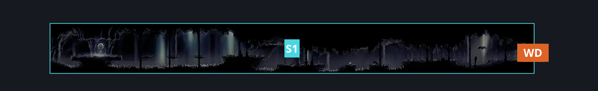
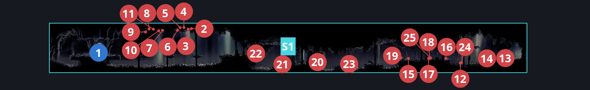
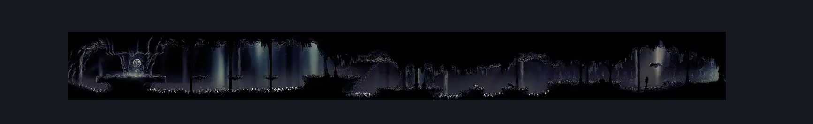

# Wormways Weavenest (Crawl_05)

**Game ID:** Crawl_05

**Contributors:** herounit, cry

## Subrooms

| No. | Subroom | Annotated |
| --- | --- | --- |
| S1 | weavenest hall | ✓ |

## Room Transitions

| Alias | Name | From subroom | Destination | Destination alias | Requirements | TODO | Verification | Annotated | Notes |
| --- | --- | --- | --- | --- | --- | --- | --- | --- | --- |
| WD | weaver door | weavenest hall | [Wormways Upper West (Crawl_03)](wormways-upper-west.md) | WD | needolin |  | Verified | ✓ |  |

## Subroom Connections

No subroom connections defined.

## Check Locations

| No. | Check | Subroom | Requirements | TODO | Verification | Location Type | Annotated | Notes |
| --- | --- | --- | --- | --- | --- | --- | --- | --- |
| 1 | sharpdart | weavenest hall | none |  | Verified | collectible | ✓ |  |
| 2 | Grom 1 | weavenest hall | none |  | Verified | enemy | ✓ |  |
| 3 | Grom 2 | weavenest hall | none |  | Verified | enemy | ✓ |  |
| 4 | Grom 3 | weavenest hall | none |  | Verified | enemy | ✓ |  |
| 5 | Grom 4 | weavenest hall | none |  | Verified | enemy | ✓ |  |
| 6 | Grom 5 | weavenest hall | none |  | Verified | enemy | ✓ |  |
| 7 | Grom 6 | weavenest hall | none |  | Verified | enemy | ✓ |  |
| 8 | Grom 7 | weavenest hall | none |  | Verified | enemy | ✓ |  |
| 9 | Grom 8 | weavenest hall | none |  | Verified | enemy | ✓ |  |
| 10 | Grom 9 | weavenest hall | none |  | Verified | enemy | ✓ |  |
| 11 | Grom 10 | weavenest hall | none |  | Verified | enemy | ✓ |  |
| 12 | Gromling 1 | weavenest hall | Normal World Spawn |  | Verified | enemy | ✓ |  |
| 13 | Gromling 2 | weavenest hall | Normal World Spawn |  | Verified | enemy | ✓ |  |
| 14 | Gromling 3 | weavenest hall | Normal World Spawn |  | Verified | enemy | ✓ |  |
| 15 | Gromling 4 | weavenest hall | Normal World Spawn |  | Verified | enemy | ✓ |  |
| 16 | Gromling 5 | weavenest hall | Normal World Spawn |  | Verified | enemy | ✓ |  |
| 17 | Gromling 6 | weavenest hall | Normal World Spawn |  | Verified | enemy | ✓ |  |
| 18 | Gromling 7 | weavenest hall | Normal World Spawn |  | Verified | enemy | ✓ |  |
| 19 | Gromling 8 | weavenest hall | Normal World Spawn |  | Verified | enemy | ✓ |  |
| 20 | Gromling 9 | weavenest hall | Normal World Spawn |  | Verified | enemy | ✓ |  |
| 21 | Gromling 10 | weavenest hall | Normal World Spawn |  | Verified | enemy | ✓ |  |
| 22 | Gromling 11 | weavenest hall | Normal World Spawn |  | Verified | enemy | ✓ |  |
| 23 | Weaver Servitor Broken (1) 1 | weavenest hall | none |  | Verified | enemy | ✓ |  |
| 24 | Plasmid 1 | weavenest hall | Black Thread World Spawn |  | Verified | enemy | ✓ |  |
| 25 | Plasmid 2 | weavenest hall | Black Thread World Spawn |  | Verified | enemy | ✓ |  |

## Notes

cry: would any difficulty modifiers be appropriate? ledge grab and horizontal movement abilities are unnecessary but make it considerably easier to deal with the worms, finding a safe gap to cross is pretty strict without them, just trying to be conscious of room rando
11/14 cry: plasmid spawns didn't appear to be imported w/ enemy import, manually placed as close to their starting spawn as possible; Grom spawns unaffected by Act 3, Weaver's shrine probably provides some in-lore safe zone to them

## Room Images

### Connections

### Checks

### Scene

